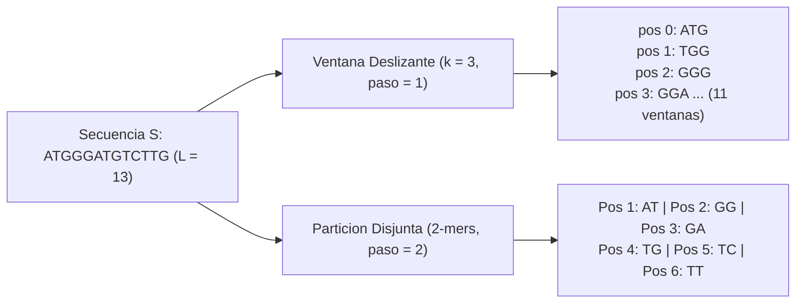
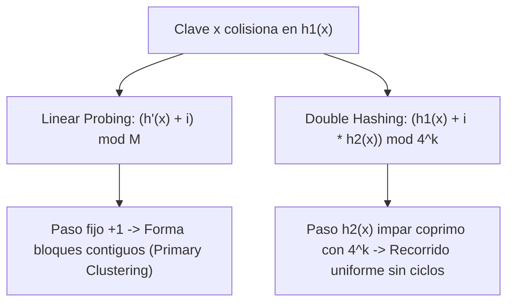
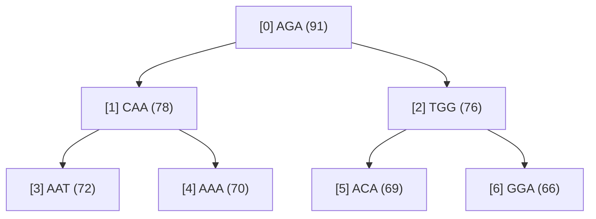
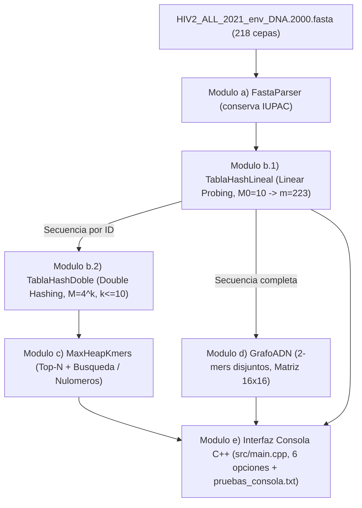

# Diseño e Implementación de un Sistema de Análisis Genómico para Secuencias de HIV-2 Basado en Tablas Hash, Montículos Binarios y Grafos Dirigidos Ponderados de *k*-mers

**Autor:**  
[Apellidos, Nombres] — `[Código de alumno]@aloe.ulima.edu.pe`  
Universidad de Lima

---

## Resumen

El análisis computacional de secuencias genómicas del virus de inmunodeficiencia humana tipo 2 (HIV-2) exige indexar colecciones extensas en formato FASTA, cuantificar subcadenas nucleotídicas características (*k*-mers) e identificar relaciones estructurales entre pares de bases sin recurrir al alto costo del alineamiento múltiple.

Para abordar este problema, se diseñó e implementó en C++17 un sistema modular libre de contenedores asociativos de la biblioteca estándar, integrando cinco componentes: un analizador léxico basado en arreglos dinámicos que preserva códigos ambiguos IUPAC sin provocar corrimientos de fase; una primera tabla hash con sondeo lineal y redimensionamiento primo dinámico al superar el factor de carga unitario; una segunda tabla hash con doble dispersión de capacidad $4^k$ para conteo mediante ventana deslizante y búsqueda puntual de *k*-mers o nulómeros; un montículo binario máximo para extraer los $n$ patrones dominantes; y un grafo dirigido ponderado con matriz de adyacencia de 16 vértices.

Las pruebas sobre 218 cepas del gen `env` de HIV-2 (561 104 pares de bases) confirmaron que las tablas hash alcanzaron la menor complejidad temporal esperada de $\mathcal{O}(1)$ en indexación y búsqueda, frente al costo $\mathcal{O}(4^k + (U + n) \log U)$ del montículo binario y $\Theta(L^2)$ de la matriz de adyacencia del grafo. En la cepa `MAC.US.x.239.M33262` (2640 pb), el doble hashing con incremento impar redujo las sondas promedio en 26.0 % para 3-mers y 17.1 % para 6-mers respecto al sondeo lineal.

Se concluye que la combinación de direccionamiento abierto con doble dispersión, montículos binarios y grafos de dinucleótidos constituye una arquitectura determinista, replicable y eficiente para la comparación genómica libre de alineamiento.

**Palabras Clave:** Análisis genómico, HIV-2, formato FASTA, k-mers, nulómeros, tablas hash, linear probing, double hashing, max-heap, grafos dirigidos ponderados, matriz de adyacencia.

---

## 1. INTRODUCCIÓN

El crecimiento exponencial de secuencias de ácido desoxirribonucleico (ADN) en repositorios genómicos públicos demanda herramientas computacionales capaces de extraer patrones estructurales y evaluar similitud evolutiva en agentes patógenos de rápida mutación, como el virus de inmunodeficiencia humana tipo 2 (HIV-2). Los métodos tradicionales basados en alineamiento global o múltiple presentan severas restricciones de escalabilidad cuando las cadenas exhiben reordenamientos o alta divergencia genética (Zielezinski et al., 2017). Frente a esta limitación, resulta necesario construir un sistema eficiente que permita indexar colecciones en formato FASTA, contabilizar subcadenas contiguas de longitud $k$ (*k*-mers), detectar variantes ausentes (nulómeros) y modelar transiciones entre dinucleótidos sin requerir alineamiento previo.

En la literatura especializada, la elección de estructuras de datos adecuadas ha sido determinante para resolver problemas similares. Pevzner et al. (2001) y Compeau et al. (2011) representaron la descomposición de secuencias en *k*-mers mediante grafos dirigidos de De Bruijn para transformar el ensamblaje genómico en recorridos tratables. Para el conteo veloz de *k*-mers en memoria principal, Marçais y Kingsford (2011) propusieron *Jellyfish* sobre tablas hash de direccionamiento abierto, mientras que Melsted y Pritchard (2011) combinaron filtros de Bloom con tablas hash para reducir el consumo espacial. Por su parte, Hampikian y Andersen (2007) emplearon tablas directas para identificar nulómeros de relevancia biológica en genomas virales y humanos. En el ámbito de grafos ponderados, Qi et al. (2011), Das et al. (2020) y, más recientemente, Khan et al. (2024) demostraron que representar secuencias como grafos dirigidos sobre dinucleótidos o tripletes permite generar matrices de adyacencia precisas para el análisis filogenético libre de alineamiento.

En la presente investigación se planteó diseñar e implementar en C++17 un mini sistema de análisis genómico aplicado al conjunto de cepas del gen *env* de HIV-2. Como estrategia de solución, todas las estructuras se codificaron manualmente sin contenedores asociativos de la biblioteca estándar: un analizador léxico FASTA basado en arreglos dinámicos que preserva bases ambiguas IUPAC; una Tabla Hash 1 con *linear probing* y redimensionamiento al siguiente primo que restituye el factor de carga cerca de `0.5` cuando supera la unidad; una Tabla Hash 2 con *double hashing* de capacidad $4^k$ para conteo y consulta puntual de *k*-mers; un *max-heap* binario para extraer los $n$ patrones más frecuentes; y un grafo dirigido ponderado con matriz de adyacencia según Khan et al. (2024), articulados bajo una interfaz interactiva en consola de seis opciones con un protocolo reproducible de validación.

El resto del documento se estructura de la siguiente forma. La Sección 2 desarrolla los antecedentes biológicos de ADN, HIV-2 y formato FASTA, junto con los fundamentos teóricos de las estructuras empleadas. La Sección 3 presenta la metodología de integración, la especificación formal de los algoritmos y su análisis de complejidad computacional. La Sección 4 detalla la implementación en C++17, los criterios de replicabilidad y los resultados experimentales obtenidos. La Sección 5 discute comparativamente las decisiones de diseño frente a alternativas clásicas, y la Sección 6 sintetiza las conclusiones, seguidas por los aportes, el uso de herramientas de IA y las referencias bibliográficas.

---

## 2. ANTECEDENTES

### 2.1 Bases Teóricas de Cadenas de ADN, HIV-2 y Formato FASTA

Formalmente, una cadena de ADN se representa como una secuencia finita $S = s_0 s_1 \dots s_{L-1}$ de longitud $L$ sobre el alfabeto nucleotídico $\Sigma = \{\text{A}, \text{T}, \text{C}, \text{G}\}$ (Adenina, Timina, Citosina y Guanina). En el estudio del retrovirus HIV-2, particularmente en el gen de la envoltura (*env*), la composición estadística de subcadenas permite identificar firmas conservadas, mutaciones relevantes y afinidad evolutiva entre subtipos sin alinear genomas completos (Zielezinski et al., 2017).

Un *k*-mer es toda subcadena contigua de longitud $k$ extraída mediante ventana deslizante de desplazamiento unitario, generando $L - k + 1$ ventanas sobre un universo combinatorio de tamaño $4^k$. Aquellos *k*-mers cortos posibles dentro de $\Sigma^k$ que no ocurren en una secuencia se denominan *nulómeros*, patrones útiles para caracterizar restricciones biológicas o alteraciones patológicas (Hampikian & Andersen, 2007). Por otro lado, el modelo de grafos de Khan et al. (2024) divide la cadena en $P = \lfloor L/2 \rfloor$ pares disjuntos consecutivos (2-mers) pertenecientes al alfabeto $\Sigma^2$ de 16 dinucleótidos. En bioinformática, estas colecciones se almacenan en archivos de texto **FASTA** (Lipman & Pearson, 1985), donde cada entrada inicia con una cabecera `>ID` seguida por líneas de secuencia que pueden contener ocasionalmente códigos de ambigüedad IUPAC (como `R, Y, W, K, M, N`), los cuales deben filtrarse por ventana o par sin suprimir posiciones intermedias ni desplazar el marco de lectura. En la Figura 1 se observa la diferencia entre ambos esquemas de descomposición.


*Fig. 1. Comparación entre extracción de 3-mers por ventana deslizante unitaria y partición en 2-mers disjuntos sobre `ATGGGATGTCTTG`. Fuente: Elaboración propia.*

### 2.2 Estructuras de Datos Utilizadas

**Arreglos Dinámicos y Registros:** Para almacenar un número desconocido de secuencias FASTA o nodos de un montículo se utilizan arreglos asignados dinámicamente con duplicación geométrica de capacidad al alcanzar el límite actual. Mediante análisis potencial, $N$ inserciones consecutivas requieren un costo amortizado $\mathcal{O}(1)$ por elemento y aprovechan la contigüidad espacial de memoria en caché (Cormen et al., 2022; Weiss, 2014).

**Tablas Hash con Direccionamiento Abierto:** Una tabla hash implementa un diccionario sobre un arreglo $T[0 \dots M-1]$ asociando claves textuales mediante hashing polinómico evaluado por la regla de Horner con base prima $B$:

$$h'(S) = \left( \sum_{i=0}^{|S|-1} \text{ASCII}(S[i]) \cdot B^{|S|-1-i} \right) \bmod M$$

El grado de saturación se mide por el factor de carga $\alpha = N / M$ (Sedgewick & Wayne, 2011). En direccionamiento abierto, cuando ocurre una colisión se explora una secuencia determinista de sondas $h(x, i)$ (Cormen et al., 2022; Knuth, 1998):
1. **Linear Probing:** explora $h(x, i) = (h'(x) + i) \bmod M$; aunque favorece la caché secuencial, padece *agrupamiento primario* (*primary clustering*), donde las colisiones fusionan bloques contiguos y degradan la búsqueda cuando $\alpha \to 1$ (Knuth, 1998; Weiss, 2014), mitigándose mediante *rehashing* hacia un primo $m \approx 2N$.
2. **Double Hashing:** combina dos funciones independientes mediante $h(x, i) = (h_1(x) + i \cdot h_2(x)) \bmod M$. Para recorrer todas las $M$ casillas sin subciclos, debe cumplirse $\gcd(h_2(x), M) = 1$ (Cormen et al., 2022). Cuando $M = 4^k = 2^{2k}$, elegir siempre un incremento impar positivo $h_2(x) \in \{1, 3, \dots, M-1\}$ satisface dicha coprimalidad y elimina el agrupamiento primario y secundario (Sedgewick & Wayne, 2011). En la Figura 2 se observa el contraste estructural de ambas secuencias de sondeo.


*Fig. 2. Esquema comparativo entre Linear Probing (agrupamiento primario) y Double Hashing con salto impar coprimo con $4^k$. Fuente: Elaboración propia basada en Cormen et al. (2022).*

**Montículo Binario Máximo (Max-Heap):** Es un árbol binario casi completo almacenado sin punteros explícitos en un arreglo contiguo $H[0 \dots U-1]$ donde $\text{padre}(i) = \lfloor (i - 1)/2 \rfloor$, $\text{izq}(i) = 2i + 1$ y $\text{der}(i) = 2i + 2$ (Cormen et al., 2022; Brass, 2008). Satisface la invariante $H[\text{padre}(i)].\text{conteo} \ge H[i].\text{conteo}$, asegurando que el patrón de mayor frecuencia resida en `H[0]` y permitiendo extracciones sucesivas mediante reajuste descendente (*heapify-down*) en tiempo logarítmico (Weiss, 2014). En la Figura 3 se observa la correspondencia entre el árbol lógico y el arreglo físico 0-indexado para los 3-mers más frecuentes de `MAC.US.x.239.M33262`.


*Fig. 3. Mapeo lógico y físico de un Max-Heap binario de 3-mers en arreglo 0-indexado. Fuente: Elaboración propia.*

**Grafos Dirigidos Ponderados y Matriz de Adyacencia:** Un digrafo ponderado con bucles $G = (V, E, w)$ sobre $|V| \le 16$ vértices dinucleotídicos se representa eficazmente mediante una matriz de adyacencia $A \in \mathbb{R}^{16 \times 16}$ con actualización directa en $\mathcal{O}(1)$ (Cormen et al., 2022; Mehlhorn & Sanders, 2008). Siguiendo a Qi et al. (2011), Das et al. (2020) y Khan et al. (2024), cada pareja de posiciones ordenadas $1 \le i < j \le P$ con dinucleótidos válidos $u = p_i$ y $v = p_j$ agrega un arco dirigido de peso $d(i, j) = 1 / (j - i)^\beta$, reduciendo aristas paralelas mediante la suma $A[u][v] = \sum 1 / (j - i)^\beta$ para capturar la firma posicional global de la secuencia.

---

## 3. ANÁLISIS

### 3.1 Metodología e Integración del Sistema

La solución adopta una arquitectura modular por etapas donde cada estructura transforma la salida de la anterior manteniendo independencia entre algoritmos e interfaz. En la Figura 4 se observa el flujo completo: el módulo **a)** (`FastaParser`) lee las cepas del archivo FASTA preservando letras IUPAC para no alterar coordenadas; el módulo **b.1)** (`TablaHashLineal`) indexa las secuencias por identificador con *linear probing* y rehash primo; a partir de una cepa consultada en $\mathcal{O}(1)$ esperado, el módulo **b.2)** (`TablaHashDoble`) construye la tabla de frecuencias de *k*-mers de tamaño $4^k$ para alimentar tanto al módulo **c)** (`MaxHeapKmers`) en la extracción del Top-$n$ como a las consultas puntuales de patrones o nulómeros; paralelamente, el módulo **d)** (`GrafoADN`) construye el digrafo ponderado de 2-mers disjuntos y su matriz de adyacencia; y finalmente el módulo **e)** (`src/main.cpp`) expone todas las operaciones en un menú textual validado de seis opciones y un puerto opcional `--server` JSON.


*Fig. 4. Diagrama de arquitectura e integración modular de los cinco componentes del sistema en C++17. Fuente: Elaboración propia.*

### 3.2 Especificación Formal de Algoritmos

En el Algoritmo 1, se observa el diseño formal de la Tabla Hash 1 basada en *linear probing* (Cormen et al., 2022). Antes de ejecutar un redimensionamiento cuando el factor de carga proyectado $(N + 1) / M$ supera `1.0`, `InsertarTablaHashLineal` verifica si la clave ya reside en la tabla para actualizar su secuencia sin un *rehash* innecesario; si es nueva, calcula el menor primo $m \ge 2(N + 1)$ mediante `SiguientePrimo` y reubica los elementos con `Redimensionar`. Complementariamente, `BuscarTablaHashLineal` sondea desde la posición inicial hasta hallar la clave o una casilla vacía.

```text
Algoritmo 1: Operaciones en Tabla Hash 1 con Linear Probing y Redimensionamiento Primo
Algoritmo InsertarTablaHashLineal(T, seq)
    if (T.elementos + 1) / T.capacidad > 1.0 then
        posCheck ← FuncionHash(seq.id, T.capacidad);  i ← 0
        while i < T.capacidad ∧ T.tabla[(posCheck + i) mod T.capacidad].ocupado do
            idx ← (posCheck + i) mod T.capacidad
            if T.tabla[idx].dato.id = seq.id then  T.tabla[idx].dato.sequence ← seq.sequence;  return
            i ← i + 1
        primoM ← SiguientePrimo(2 * (T.elementos + 1))
        Redimensionar(T, primoM)
    posInicial ← FuncionHash(seq.id, T.capacidad);  i ← 0
    while i < T.capacidad do
        idx ← (posInicial + i) mod T.capacidad
        if ∼T.tabla[idx].ocupado then
            T.tabla[idx].dato ← seq;  T.tabla[idx].ocupado ← V;  T.elementos ← T.elementos + 1;  return
        if T.tabla[idx].dato.id = seq.id then  T.tabla[idx].dato.sequence ← seq.sequence;  return
        i ← i + 1
Algoritmo Redimensionar(T, m)
    tablaVieja ← T.tabla;  capVieja ← T.capacidad;  T.capacidad ← m;  T.elementos ← 0
    T.tabla ← NuevoArreglo(CasillaSeq, m)
    for i ← 0 to capVieja - 1 do
        if tablaVieja[i].ocupado then  InsertarTablaHashLineal(T, tablaVieja[i].dato)
    Liberar(tablaVieja)
Algoritmo BuscarTablaHashLineal(T, id)
    posInicial ← FuncionHash(id, T.capacidad);  i ← 0
    while i < T.capacidad do
        idx ← (posInicial + i) mod T.capacidad
        if ∼T.tabla[idx].ocupado then  return 𝜙
        if T.tabla[idx].dato.id = id then  return Referencia(T.tabla[idx].dato)
        i ← i + 1
    return 𝜙
```

En el Algoritmo 2, se observa la formalización de la Tabla Hash 2 con *double hashing* sobre $M = 4^k$ casillas (Cormen et al., 2022). El procedimiento `ProcesarSecuenciaDobleHash` desliza una ventana de ancho $k$ ($1 \le k \le 10$), valida que la subcadena pertenezca a $\{\text{A}, \text{T}, \text{C}, \text{G}\}^k$ y aplica dos hashes polinómicos con salto impar $h_2$ tanto en la inserción como en la consulta `BuscarKmerDoble`.

```text
Algoritmo 2: Conteo y Búsqueda de k-mers mediante Double Hashing (M = 4^k)
Algoritmo ProcesarSecuenciaDobleHash(T, S, k)
    ConfigurarTamano(T, k)        // acota 1 ≤ k ≤ 10 y fija T.capacidad ← 4^k
    for pos ← 0 to Longitud(S) - T.longitudK do
        InsertarKmerDoble(T, Subcadena(S, pos, T.longitudK))
Algoritmo InsertarKmerDoble(T, w)
    if (Longitud(w) ≠ T.longitudK) ∨ (∼EsKmerValido(w)) then  return
    h1 ← Hash1(w) mod T.capacidad;  h2 ← ((Hash2(w) mod (T.capacidad / 2)) * 2) + 1;  i ← 0
    while i < T.capacidad do
        idx ← (h1 + i * h2) mod T.capacidad
        if ∼T.tabla[idx].ocupado then
            T.tabla[idx].kmer ← w;  T.tabla[idx].conteo ← 1;  T.tabla[idx].ocupado ← V;  T.kmersUnicos ← T.kmersUnicos + 1;  return
        if T.tabla[idx].kmer = w then  T.tabla[idx].conteo ← T.tabla[idx].conteo + 1;  return
        i ← i + 1
Algoritmo BuscarKmerDoble(T, w)
    w' ← AMayusculas(w)
    if (Longitud(w') ≠ T.longitudK) ∨ (∼EsKmerValido(w')) then  return 0
    h1 ← Hash1(w') mod T.capacidad;  h2 ← ((Hash2(w') mod (T.capacidad / 2)) * 2) + 1;  i ← 0
    while i < T.capacidad do
        idx ← (h1 + i * h2) mod T.capacidad
        if ∼T.tabla[idx].ocupado then  return 0
        if T.tabla[idx].kmer = w' then  return T.tabla[idx].conteo
        i ← i + 1
    return 0
```

En el Algoritmo 3, se observa la construcción y extracción en el montículo binario máximo (Cormen et al., 2022). Cada casilla ocupada de la Tabla Hash 2 se inserta restableciendo la invariante hacia la raíz con `Subir`, mientras que `ExtraerMaximo` incluye verificación de montículo vacío y reordena la nueva raíz con `Bajar`.

```text
Algoritmo 3: Construcción y Extracción Top-n en Max-Heap Binario
Algoritmo ConstruirMaxHeap(H, T)
    H.tamano ← 0
    for i ← 0 to T.capacidad - 1 do
        if T.tabla[i].ocupado then  InsertarHeap(H, T.tabla[i].kmer, T.tabla[i].conteo)
Algoritmo InsertarHeap(H, w, c)
    if H.tamano ≥ H.capacidad then  DuplicarCapacidad(H)
    H.heap[H.tamano] ← (w, c);  Subir(H, H.tamano);  H.tamano ← H.tamano + 1
Algoritmo Subir(H, idx)
    while idx > 0 do
        padre ← (idx - 1) div 2
        if H.heap[idx].conteo > H.heap[padre].conteo then  Intercambiar(H.heap[idx], H.heap[padre]);  idx ← padre
        else  return
Algoritmo ExtraerMaximo(H)
    if H.tamano ≤ 0 then  return ("", 0)
    maximo ← H.heap[0];  H.heap[0] ← H.heap[H.tamano - 1];  H.tamano ← H.tamano - 1
    if H.tamano > 0 then  Bajar(H, 0)
    return maximo
Algoritmo Bajar(H, idx)
    while V do
        izq ← 2 * idx + 1;  der ← 2 * idx + 2;  mayor ← idx
        if (izq < H.tamano) ∧ (H.heap[izq].conteo > H.heap[mayor].conteo) then  mayor ← izq
        if (der < H.tamano) ∧ (H.heap[der].conteo > H.heap[mayor].conteo) then  mayor ← der
        if mayor ≠ idx then  Intercambiar(H.heap[idx], H.heap[mayor]);  idx ← mayor
        else  return
```

En el Algoritmo 4, se observa la construcción del grafo dirigido ponderado de dinucleótidos basada en Khan et al. (2024). Cada par de posición $p + 1$ válido en $\{\text{A}, \text{T}, \text{C}, \text{G}\}^2$ conserva su coordenada original $p + 1$ aun cuando algún bloque previo contenga bases IUPAC ambiguas, garantizando que las distancias $posJ - posI$ y la paridad del resto de la cadena permanezcan intactas.

```text
Algoritmo 4: Construcción del Grafo de 2-mers y Matriz de Adyacencia (Khan et al., 2024)
Algoritmo ConstruirGrafoADN(S, β)
    A ← MatrizCeros(16, 16);  numVertices ← 0;  cantidadPares ← 0;  totalPares ← Longitud(S) div 2
    if totalPares ≤ 0 then  return
    for p ← 0 to totalPares - 1 do
        par ← AMayusculas(Subcadena(S, p * 2, 2))
        if EsKmerValido(par) then
            v ← ObtenerOAgregarVertice(par)
            if v ≥ 0 then  listaPares[cantidadPares] ← (p + 1, par, v);  cantidadPares ← cantidadPares + 1
    for i ← 0 to cantidadPares - 1 do
        (posI, _, u) ← listaPares[i]
        for j ← i + 1 to cantidadPares - 1 do
            (posJ, _, v) ← listaPares[j]
            A[u][v] ← A[u][v] + 1.0 / (posJ - posI)^β
```

### 3.3 Análisis de Complejidad Computacional

Sea $N$ el número de secuencias FASTA, $L$ la longitud de la cadena analizada, $k$ el ancho del *k*-mer, $M_1$ la capacidad prima de la Tabla Hash 1, $M_2 = 4^k$ la capacidad de la Tabla Hash 2, $U \le \min(4^k, L - k + 1)$ el número de *k*-mers únicos, $n$ los patrones extraídos y $P = \lfloor L/2 \rfloor$ los pares del grafo: **1) FastaParser:** lee cada carácter una vez; con duplicación geométrica en `agrandarLista`, la copia acumulada suma menos de $2N$ registros, logrando tiempo $\mathcal{O}(N \cdot \bar{L})$ y espacio $\mathcal{O}(N \cdot \bar{L})$. **2) TablaHashLineal:** bajo hashing uniforme y $\alpha < 1$, las sondas esperadas son $\frac{1}{2}(1 + \frac{1}{1-\alpha}) = \mathcal{O}(1)$ (Knuth, 1998; Cormen et al., 2022). Cada *rehash* cuesta $\mathcal{O}(M_1)$ pero al duplicar capacidad hacia $m \ge 2N$ mantiene costo amortizado $\mathcal{O}(1)$ esperado (peor caso $\mathcal{O}(N)$). **3) TablaHashDoble:** inicializar $4^k$ casillas cuesta $\mathcal{O}(4^k)$ y procesar $L - k + 1$ ventanas de largo $k$ toma $\mathcal{O}(4^k + k \cdot L)$ esperado con sondas promedio $\frac{1}{\alpha}\ln\frac{1}{1-\alpha}$ y peor caso $\mathcal{O}(4^k \cdot L)$ si $\alpha \to 1$. **4) MaxHeapKmers:** recorre los $4^k$ bins e inserta $U$ elementos en $\mathcal{O}(U \log U)$, más $n$ extracciones en $\mathcal{O}(n \log U)$, totalizando $\mathcal{O}(4^k + (U + n)\log U)$. **5) GrafoADN:** el doble bucle evalúa exactamente $P(P - 1)/2$ pares ordenados, resultando en complejidad temporal exacta $\Theta(L^2)$ en todos los casos y espacio $\mathcal{O}(L)$ dada la matriz fija $16 \times 16$. La Tabla 1 resume estas cotas.

| Módulo / Estructura | Operación Principal | Mejor Caso | Caso Promedio | Peor Caso | Espacio |
| :--- | :--- | :---: | :---: | :---: | :---: |
| `FastaParser` | Carga completa FASTA | $\mathcal{O}(N \cdot \bar{L})$ | $\mathcal{O}(N \cdot \bar{L})$ | $\mathcal{O}(N \cdot \bar{L})$ | $\mathcal{O}(N \cdot \bar{L})$ |
| `TablaHashLineal` | Inserción (amortizada) | $\mathcal{O}(1)$ | $\mathcal{O}(1)$ | $\mathcal{O}(N)$ | $\mathcal{O}(M_1)$ |
| `TablaHashLineal` | Búsqueda por ID | $\mathcal{O}(1)$ | $\mathcal{O}(1)$ | $\mathcal{O}(N)$ | $\mathcal{O}(M_1)$ |
| `TablaHashDoble` | Procesar secuencia ($L$) | $\mathcal{O}(4^k + k \cdot L)$ | $\mathcal{O}(4^k + k \cdot L)$ | $\mathcal{O}(4^k \cdot L)$ | $\mathcal{O}(4^k)$ |
| `TablaHashDoble` | Búsqueda de *k*-mer | $\mathcal{O}(k)$ | $\mathcal{O}(k)$ | $\mathcal{O}(k + 4^k)$ | $\mathcal{O}(4^k)$ |
| `MaxHeapKmers` | Construcción + Top-$n$ | $\mathcal{O}(4^k + U + n\log U)$ | $\mathcal{O}(4^k + (U+n)\log U)$ | $\mathcal{O}(4^k + (U+n)\log U)$ | $\mathcal{O}(U)$ |
| `GrafoADN` | Grafo + Matriz $16\times 16$ | $\Theta(L^2)$ | $\Theta(L^2)$ | $\Theta(L^2)$ | $\mathcal{O}(L)$ |

---

## 4. IMPLEMENTACIÓN (EXPERIMENTACIÓN)

### 4.1 Implementación Modular en C++17 y Replicabilidad

El motor completo se implementó en C++17 en módulos desacoplados dentro de `include/` y `src/`, compilables mediante `build.bat` (con `MSVC cl.exe /O2` o `g++ -std=c++17 -O2 -static`). Ninguna estructura usa contenedores asociativos ni colas de la STL; todas administran memoria manualmente mediante `new[]/delete[]` y prohíben copias accidentales por Regla de los Tres (`= delete`).

#### a) Analizador Léxico FASTA (`parser.hpp` / `parser.cpp`)
Cada cepa se almacena en `struct DNASequence { string id; string sequence; };` dentro de `FastaParser` (capacidad inicial `20`, duplicada en `agrandarLista`). El lector retira un eventual BOM UTF-8 en la primera línea, limpia saltos `\r` o tabulaciones y soporta tanto cabeceras `>ID` como archivos de una línea `ID SECUENCIA`. Crucialmente, las líneas nucleotídicas conservan todo carácter alfabético convertido a mayúscula (incluyendo códigos IUPAC), evitando borrar posiciones que desplazarían los pares del grafo o crearían subcadenas artificiales; la función `esKmerValido` rechaza cadenas vacías y acepta exclusivamente letras en `{'A','T','C','G'}`.

#### b) Tabla Hash 1: *Linear Probing* y Rehash Primo (`tablas_hash.cpp`)
`TablaHashLineal` parte con `capacidad = 10` y evalúa `funcionHash` mediante multiplicación polinómica de base `31` en `unsigned long`. Antes de redimensionar cuando `(elementos + 1) / capacidad > 1.0`, `insertar` inspecciona si el `id` ya estaba registrado para actualizarlo sin provocar un *rehash* redundante; de ser una clave nueva, llama a `siguientePrimo((elementos + 1) * 2)` (donde `esPrimo` itera hasta `i <= n / i` sin riesgo de desbordamiento) y reubica las casillas activas en `redimensionar`:

```cpp
if ((double)(elementos + 1) / capacidad > 1.0) {
    // Pre-chequeo: si el ID ya existe se actualiza in-situ; si es nuevo se rehashea a m >= 2*(N+1)
    int primoM = siguientePrimo((elementos + 1) * 2);
    redimensionar(primoM);
}
```

#### c) Tabla Hash 2: *Double Hashing* sobre $4^k$ casillas (`tablas_hash.cpp`)
`TablaHashDoble` acota $k$ al rango seguro `1 <= k <= MAX_K_VALIDO (10)` (hasta $4^{10} = 1\,048\,576$ casillas) y reutiliza el arreglo ya reservado cuando `capacidad == potenciaDeCuatro(nuevoK)`. Las funciones `hash1` (base `37`) y `hash2` (base `53`) operan en `unsigned long long` para evitar desbordamientos en `h1 + i * h2`:

```cpp
unsigned long TablaHashDoble::hash2(const string& kmer) const {
    unsigned long long h = 0;
    for (int i = 0; i < (int)kmer.length(); i++) h = (h * 53ULL) + (unsigned char)kmer[i];
    return (unsigned long)(((h % (unsigned long long)(capacidad / 2)) * 2ULL) + 1ULL); // paso impar
}
```

#### d) *Max-Heap* Binario y Grafo de 2-mers (`max_heap.cpp`, `grafo_adn.cpp`)
`MaxHeapKmers` inicializa un arreglo de capacidad `64` con duplicación dinámica. `construirDesdeTablaHash` inserta los pares `(kmer, conteo)` aplicando `subir` sobre `(idx - 1) / 2`, mientras `extraerMaximo` protege el caso `tamano <= 0` retornando `{"", 0}` y reajustando la raíz con `bajar`. En `GrafoADN`, `obtenerOAgregarVertice` valida el límite `numVertices < 16` y `construirGrafo` almacena un arreglo auxiliar `vertIdx` de índices de vértice para que el bucle cuadrático acumule directamente `matriz[u][v] += 1.0 / pow(dist, beta)` sin búsquedas repetidas.

#### e) Interfaz Textual en Consola C++ y Protocolo de Pruebas (`main.cpp`)
`src/main.cpp` implementa un menú interactivo por consola con seis opciones operativas: **(1)** buscar secuencia por ID en Tabla Hash 1; **(2)** contar *k*-mers en Tabla Hash 2 y extraer el Top-$n$ con Max-Heap; **(3)** construir el grafo y matriz de adyacencia de cualquier cepa para $\beta > 0$; **(4)** validar el ejemplo de grafo del enunciado (`TCATTAGCAGTTAGCAGC`); **(5)** validar el ejemplo de 3-mers (`ATGGGATGTCTTG`); y **(6)** buscar un *k*-mer específico en la Tabla Hash 2 activa para verificar frecuencias o nulómeros. Se incorporaron los lectores seguros `leerEntero` y `leerDouble` para rechazar texto no numérico o valores fuera de rango sin cierres abruptos ni bucles infinitos. Complementariamente, el parámetro `--server` mantiene un canal JSON por `stdin/stdout` para la futura interfaz gráfica en Python.

> **Replicabilidad y enlace del proyecto:** Repositorio del código fuente: *[Insertar enlace de GitHub o Google Drive del proyecto aquí]*. Para replicar los experimentos basta compilar con `.\build.bat` (genera `genomic_engine.exe`) y ejecutar manualmente o en bloque las pruebas reproducibles incluidas en `pruebas_consola.txt` (Casos 0 al 9 en PowerShell).

### 4.2 Resultados Experimentales y Validación

**Experimento 1 (Carga FASTA y Tabla Hash 1):** El archivo `HIV2_ALL_2021_env_DNA.2000.fasta` registró exactamente **218 secuencias** (longitudes entre 2395 y 2700 pb, total 561 104 pb), de las cuales 11 cepas contienen en conjunto 63 caracteres ambiguos IUPAC (`K, M, N, R, W, Y`). Al indexarlas desde capacidad $M_0 = 10$, la Tabla Hash 1 ejecutó cuatro redimensionamientos primos (Tabla 2), finalizando en `m = 223` con factor de carga `0.977578`. En la Opción 1 se recuperaron las 218/218 cepas con longitudes exactas (ej. `MAC.US.x.239.M33262` con 2640 pb en 1 sonda y `NO_EXISTE` descartado en 76 sondas).

| Evento de Rehash | Elementos Previos ($N$) | Capacidad Previa ($M$) | Siguiente Primo ($m$) | Load Factor Post-Rehash ($\alpha$) |
| :---: | :---: | :---: | :---: | :---: |
| Rehash #1 | `10` | `10` | `23` | `11 / 23 = 0.4783` |
| Rehash #2 | `23` | `23` | `53` | `24 / 53 = 0.4528` |
| Rehash #3 | `53` | `53` | `109` | `54 / 109 = 0.4954` |
| Rehash #4 | `109` | `109` | `223` | `110 / 223 = 0.4933` |

**Experimento 2 (*k*-mers, Max-Heap, Nulómeros e Integridad IUPAC):** La Opción 5 validó `ATGGGATGTCTTG` en $4^3 = 64$ bins reproduciendo exactamente `ATG: 2, TGG: 1, GGG: 1, GGA: 1, GAT: 1`. Sobre `MAC.US.x.239.M33262` (2640 pb), la Opción 2 se verificó exhaustivamente para $k = 1 \dots 9$, coincidiendo al 100 % con conteos independientes y en orden monótono no creciente (Tabla 3 para $k = 3$ y $k = 6$). Con la Opción 6 sobre $k = 6$, las consultas `ACTTGG` y `acttgg` devolvieron frecuencia `6` en 1 sonda, mientras que `CCCCCC` retornó frecuencia `0` en 1 sonda (nulómero local). Asimismo, en la cepa `A.FR.02.LA36GomM.KU168287` (2610 pb con una base `R` en posición 1239), la conservación de caracteres IUPAC evitó corrimientos de fase y filtró únicamente las 3 ventanas afectadas (`2605` ventanas válidas, `CAG = 67`, `AGG = 59`).

| Ranking | 3-mer ($M = 64$, únicos = 64) | Frecuencia | 6-mer ($M = 4096$, únicos = 1705) | Frecuencia |
| :---: | :---: | :---: | :---: | :---: |
| `#1` | `AGA` | `91` | `AACAGC` | `6` |
| `#2` | `CAA` | `78` | `CAAGAG` | `6` |
| `#3` | `TGG` | `76` | `ACTTGG` | `6` |
| `#4` | `AAT` | `72` | `TTGGTT` | `5` |
| `#5` | `AAA` | `70` | `CAACAG` | `5` |
| `#6` | `ACA` | `69` | `AAGAGA` | `5` |
| `#7` | `GGA` | `66` | `GAACAA` | `5` |
| `#8` | `ATG` | `64` | `GAGACT` | `5` |
| `#9` | `ATA` | `63` | `TGGTTT` | `5` |
| `#10` | `CAG` | `63` | `GAGAAG` | `5` |

**Experimento 3 (Grafo de ADN, Matriz de Adyacencia y Robustez):** Mediante la Opción 4 con `TCATTAGCAGTTAGCAGC` y $\beta = 1$, `GrafoADN` extrajo los 9 pares (`1:TC … 9:GC`) y obtuvo exactamente `w(TC, AT) = 1.00000` y `w(AT, CA) = 0.16667`, generando la matriz $7 \times 7$ de la Tabla 4 (donde por ejemplo $w(\text{AG}, \text{CA}) = 1/(8-5) + 1/(8-7) = 1.3333$ y el bucle $w(\text{AG}, \text{AG}) = 1/(7-5) = 0.5000$). Cabe señalar que, a diferencia de la Figura 5 de Khan et al. (2024) —que normaliza adicionalmente por el peso máximo $4/3$ en una matriz fija $16 \times 16$ alfabética—, la implementación reporta los pesos directos exigidos por las especificaciones del proyecto. Para la cepa completa `MAC.US.x.239.M33262` (Opción 3, 1320 pares), los 16 dinucleótidos formaron una matriz densa con máximos en `AA→CA = 85.0561` y `AA→AA = 84.3654`, y mínimos en `CG→CG = 3.1053` consistente con la supresión de dinucleótidos CpG en retrovirus. Finalmente, la suite de 10 casos de `pruebas_consola.txt` aprobó con código de salida `0`, verificando además el rechazo controlado de entradas inválidas (`k ∈ {0, -1, 16, abc}`, `n = 0`, `β ∈ {-1, 0, xyz}`).

| Vértice | `TC` | `AT` | `TA` | `GC` | `AG` | `TT` | `CA` |
| :---: | :---: | :---: | :---: | :---: | :---: | :---: | :---: |
| **`TC`** | `0.0000` | `1.0000` | `0.5000` | `0.4583` | `0.4167` | `0.2000` | `0.1429` |
| **`AT`** | `0.0000` | `0.0000` | `1.0000` | `0.6429` | `0.5333` | `0.2500` | `0.1667` |
| **`TA`** | `0.0000` | `0.0000` | `0.0000` | `1.1667` | `0.7500` | `0.3333` | `0.2000` |
| **`GC`** | `0.0000` | `0.0000` | `0.0000` | `0.2000` | `1.3333` | `0.5000` | `0.2500` |
| **`AG`** | `0.0000` | `0.0000` | `0.0000` | `0.7500` | `0.5000` | `1.0000` | `1.3333` |
| **`TT`** | `0.0000` | `0.0000` | `0.0000` | `0.3333` | `1.0000` | `0.0000` | `0.5000` |
| **`CA`** | `0.0000` | `0.0000` | `0.0000` | `1.0000` | `0.0000` | `0.0000` | `0.0000` |

---

## 5. DISCUSIÓN

### 5.1 *Double Hashing* frente a *Linear Probing* y Compromiso Tiempo-Espacio

Para evaluar empíricamente la ventaja del *double hashing* sobre el *linear probing*, se instrumentaron los contadores `totalSondas`, `colisiones` y `maxSondas` junto con el método auxiliar `contrastarConLinearProbing` usando idéntica función `hash1` y capacidad $4^k$ sobre `MAC.US.x.239.M33262`. Cada inspección a una casilla durante `insertarKmer` suma 1 sonda ($i$ colisiones si requirió $i$ desplazamientos). Los valores medidos se consignan en la Tabla 5.

| Escenario | Capacidad ($M$) | Load Factor ($\alpha$) | Método | Sondas Totales | Colisiones | Promedio | Máximo |
| :--- | :---: | :---: | :--- | :---: | :---: | :---: | :---: |
| 3-mers (2638 ventanas, 64 únicos) | `64` | `1.0000` | **Double Hashing** | `6548` | `3910` | `2.4822` | `60` |
| 3-mers (2638 ventanas, 64 únicos) | `64` | `1.0000` | Linear Probing | `8853` | `6215` | `3.3560` | `20` |
| 6-mers (2635 ventanas, 1705 únicos) | `4096` | `0.4163` | **Double Hashing** | `3332` | `697` | `1.2645` | `6` |
| 6-mers (2635 ventanas, 1705 únicos) | `4096` | `0.4163` | Linear Probing | `4021` | `1386` | `1.5260` | `27` |

Para $k = 3$ (tabla saturada, $\alpha = 1.0000$), *linear probing* exige 35.2 % más sondas totales (8853 vs. 6548, reduciendo colisiones de 6215 a 3910); para $k = 6$ ($\alpha = 0.4163$), el doble hashing reduce las colisiones prácticamente a la mitad (697 vs. 1386) y abate la latencia máxima de 27 a 6 sondas (mejora de 4.5×), aproximándose a la cota esperada $\frac{1}{\alpha}\ln\frac{1}{1-\alpha} \approx 1.293$ frente al crecimiento cuadrático $\frac{1}{2}(1 + \frac{1}{(1-\alpha)^2})$ del sondeo lineal (Cormen et al., 2022; Knuth, 1998). Por contraste, permitir que la Tabla Hash 1 opere hasta $\alpha = 0.9776$ antes de rehashear produjo `1799` sondas totales (`8.2523` promedio y pico de `131` sondas) al fusionarse cadenas contiguas de colisión (Weiss, 2014; Sedgewick & Wayne, 2011), lo que justifica recomendar umbrales de *rehash* cercanos a $\alpha = 0.70$ en producción. Asimismo, aunque fijar $M = 4^k$ elimina *rehashes* hasta $k \le 10$, para $k \ge 12$ ($4^{12} > 16.7$ millones de casillas) un esquema disperso dinámico o filtros de Bloom resultaría más económico en memoria (Marçais & Kingsford, 2011; Melsted & Pritchard, 2011).

### 5.2 *Max-Heap* frente a Ordenamiento Total

Mediante el contador `comparacionesHeap`, construir el montículo y extraer el Top-10 sobre `MAC.US.x.239.M33262` requirió solo `216` comparaciones para $k = 3$ ($U = 64$) y `3083` comparaciones para $k = 6$ ($U = 1705$). Ordenar completamente los 1705 hexámeros con un algoritmo cuadrático $\mathcal{O}(U^2)$ demandaría $\sim 1.45 \times 10^6$ comparaciones, y un ordenamiento total $\mathcal{O}(U \log_2 U)$ $\sim 18\,300$ comparaciones innecesarias cuando solo interesan los $n$ patrones dominantes (Cormen et al., 2022; Brass, 2008; Weiss, 2014).

### 5.3 Matriz de Adyacencia $16 \times 16$ frente a Listas de Adyacencia y Manejo IUPAC

Dado que las cepas de HIV-2 (~2600 pb) generan grafos densos completos de los 16 dinucleótidos, una matriz fija `double matriz[16][16]` consume apenas 2 KiB contiguos y actualiza `matriz[u][v] += w` en $\mathcal{O}(1)$ directo frente al recorrido de listas enlazadas (Mehlhorn & Sanders, 2008; Khan et al., 2024). Adicionalmente, conservar los caracteres IUPAC en el parser en lugar de suprimirlos evita introducir *k*-mers quiméricos y corrimientos de fase en ~685 pares de `A.FR.02.LA36GomM.KU168287`, preservando la validez biológica de ambas métricas.

---

## 6. CONCLUSIONES

1. Se implementó y verificó un sistema modular de análisis genómico en C++17 sobre 218 secuencias reales del gen *env* de HIV-2 sin contenedores asociativos de la STL, garantizando la integridad frente a bases ambiguas IUPAC y validando 10 casos reproducibles en consola sin fallos.
2. El análisis asintótico y experimental confirmó que las tablas hash alcanzan complejidad $\mathcal{O}(1)$ esperado (siendo la estructura más veloz del sistema), seguidas por `MaxHeapKmers` en $\mathcal{O}(4^k + (U + n)\log U)$ con 3083 comparaciones para el Top-10 de 1705 hexámeros, y `GrafoADN` en $\Theta(L^2)$ al evaluar todos los pares posicionales.
3. El *double hashing* con incremento impar sobre capacidad $4^k$ superó consistentemente al *linear probing*, reduciendo las sondas promedio en 26.0 % ($k = 3$) y 17.1 % ($k = 6$), disminuyendo a la mitad las colisiones (697 vs. 1386) y bajando el peor caso de 27 a 6 sondas; a su vez, la Tabla Hash 1 evidenció el costo del agrupamiento primario al alcanzar $\alpha = 0.9776$ (1799 sondas, pico de 131).
4. El grafo dirigido ponderado de dinucleótidos reprodujo exactamente los pesos teóricos de referencia (`w(TC, AT) = 1.00000`, `w(AT, CA) = 0.16667`) y reflejó tendencias genómicas consistentes en HIV-2, como el predominio de transiciones `AA→CA` (85.0561) y la baja transición hacia `CG` (3.1053).

---

**APORTES:**  
**Autor único ([Apellidos y Nombres]):** Diseñó e implementó íntegramente las estructuras de datos en C++17 (`parser.cpp`, `tablas_hash.cpp`, `max_heap.cpp`, `grafo_adn.cpp` y `main.cpp`), formuló los algoritmos y análisis de complejidad, ejecutó los experimentos y pruebas de correctitud reproducibles (`pruebas_consola.txt`), y redactó todas las secciones del presente informe.

**Uso de herramientas de IA:**  
Se emplearon herramientas de inteligencia artificial únicamente como apoyo auxiliar para: (1) agregar contadores de instrumentación empírica (`totalSondas`, `colisiones`, `maxSondas`, `numRehashes`, `ultimasSondasBusqueda`, `comparacionesHeap` y la simulación `contrastarConLinearProbing`) debidamente demarcados con comentarios `// [GENERADO POR IA PARA CONTRASTACION]` y sus *prompts* en el código fuente; (2) asistir en la auditoría de entradas límite y validación de la consola C++; y (3) revisar redacción y formato del documento. La lógica algorítmica central de todas las estructuras de datos fue diseñada y validada por el autor.

---

**REFERENCIAS**

* Brass, P. (2008). *Advanced data structures*. Cambridge University Press. https://doi.org/10.1017/CBO9780511800191
* Compeau, P. E. C., Pevzner, P. A., & Tesler, G. (2011). How to apply de Bruijn graphs to genome assembly. *Nature Biotechnology*, *29*(11), 987–991. https://doi.org/10.1038/nbt.2023
* Cormen, T. H., Leiserson, C. E., Rivest, R. L., & Stein, C. (2022). *Introduction to algorithms* (4th ed.). MIT Press.
* Das, S., Das, A., Bhattacharya, D. K., & Tibarewala, D. N. (2020). A new graph-theoretic approach to determine the similarity of genome sequences based on nucleotide triplets. *Genomics*, *112*(6), 4701–4714. https://doi.org/10.1016/j.ygeno.2020.08.023
* Hampikian, G., & Andersen, T. (2007). Absent sequences: Nullomers and primes. *Pacific Symposium on Biocomputing*, *12*, 355–366. https://doi.org/10.1142/9789812772435_0034
* Khan, R. H., Salamat, N., Baig, A. Q., Shaikh, Z. A., & Yousef, A. (2024). Graph-based analysis of DNA sequence comparison in closed cotton species: A generalized method to unveil genetic connections. *PLOS ONE*, *19*(9), e0306608. https://doi.org/10.1371/journal.pone.0306608
* Knuth, D. E. (1998). *The art of computer programming, Volume 3: Sorting and searching* (2nd ed.). Addison-Wesley Professional.
* Lipman, D. J., & Pearson, W. R. (1985). Rapid and sensitive protein similarity searches. *Science*, *227*(4693), 1435–1441. https://doi.org/10.1126/science.2983426
* Marçais, G., & Kingsford, C. (2011). A fast, lock-free approach for efficient parallel counting of occurrences of *k*-mers. *Bioinformatics*, *27*(6), 764–770. https://doi.org/10.1093/bioinformatics/btr011
* Mehlhorn, K., & Sanders, P. (2008). *Algorithms and data structures: The basic toolbox*. Springer. https://doi.org/10.1007/978-3-540-77978-0
* Melsted, P., & Pritchard, J. K. (2011). Efficient counting of *k*-mers in DNA sequences using a bloom filter. *BMC Bioinformatics*, *12*(1), 333. https://doi.org/10.1186/1471-2105-12-333
* Pevzner, P. A., Tang, H., & Waterman, M. S. (2001). An Eulerian path approach to DNA fragment assembly. *Proceedings of the National Academy of Sciences*, *98*(17), 9748–9753. https://doi.org/10.1073/pnas.171285098
* Qi, X., Wu, Q., Zhang, Y., Fuller, E., & Zhang, C. Q. (2011). A novel model for DNA sequence similarity analysis based on graph theory. *Evolutionary Bioinformatics*, *7*, 149–158. https://doi.org/10.4137/EBO.S7364
* Sedgewick, R., & Wayne, K. (2011). *Algorithms* (4th ed.). Addison-Wesley Professional.
* Weiss, M. A. (2014). *Data structures and algorithm analysis in C++* (4th ed.). Pearson.
* Zielezinski, A., Vinga, S., Almeida, J., & Karlowski, W. M. (2017). Alignment-free sequence comparison: Benefits, applications, and tools. *Genome Biology*, *18*(1), 186. https://doi.org/10.1186/s13059-017-1319-7
