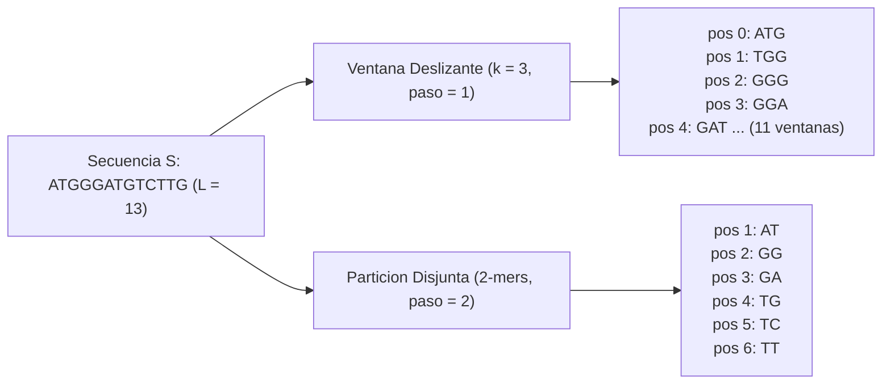
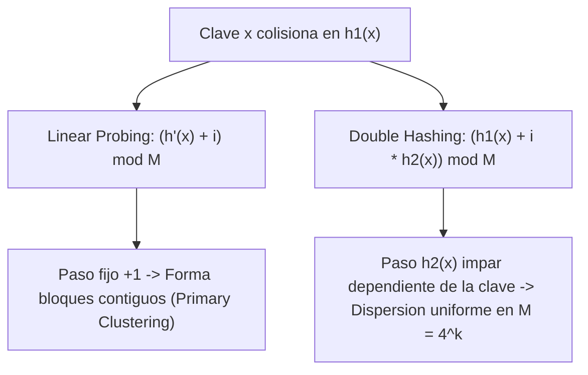
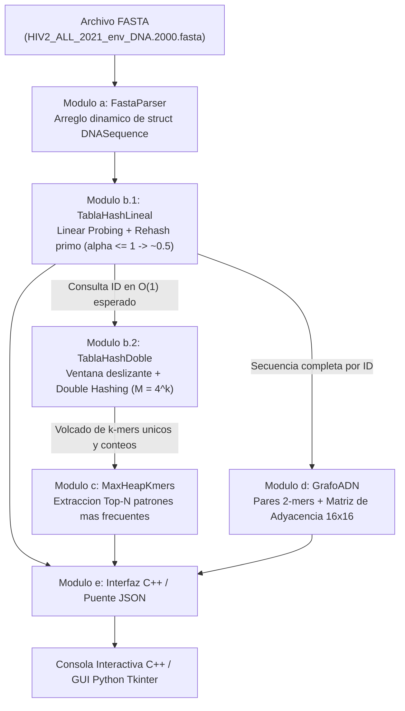

# Diseño e Implementación de un Sistema de Análisis Genómico para Secuencias de HIV-2 Basado en Tablas Hash con Direccionamiento Abierto, Montículos Binarios y Grafos Dirigidos Ponderados de *k*-mers

**Autor:**  
Apellidos, Nombres — `[Código de alumno]@aloe.ulima.edu.pe`  

**Institución:**  
Universidad de Lima — Facultad de Ingeniería, Carrera de Ingeniería de Sistemas  
Curso: Estructuras de Datos y Algoritmos

---

## Resumen

El análisis computacional del virus de inmunodeficiencia humana tipo 2 (HIV-2) exige identificar subcadenas nucleotídicas características (*k*-mers) y relaciones entre pares de bases sin recurrir a métodos de alineamiento múltiple de alto costo. Asimismo, indexar archivos FASTA requiere estructuras de datos eficientes en tiempo y memoria.

Para resolver este problema, se implementó en C++ un sistema modular libre de contenedores asociativos de la biblioteca estándar. Un analizador léxico carga las secuencias en un arreglo dinámico y las indexa en una tabla hash con *linear probing* y redimensionamiento primo dinámico; una segunda tabla hash con *double hashing* de tamaño $4^k$ contabiliza frecuencias de *k*-mers mediante ventana deslizante; un *max-heap* binario extrae los $n$ patrones dominantes; y un grafo dirigido ponderado construye la matriz de adyacencia $16 \times 16$ entre 2-mers disjuntos.

En los experimentos con `218` secuencias del gen `env` de HIV-2 (`561 104 pb`), las tablas hash alcanzaron la menor complejidad temporal con inserciones y búsquedas en $\mathcal{O}(1)$ esperado, frente al *max-heap* ($\mathcal{O}(4^k + (U+n)\log U)$) y al grafo ponderado ($\Theta(L^2)$). Para la cepa `MAC.US.x.239.M33262` (`2640 pb`), se extrajeron los 64 3-mers posibles (`AGA = 91`), `1705` 6-mers únicos y la matriz de transiciones entre dinucleótidos.

Se concluye que el *double hashing* con paso impar sobre capacidad $4^k$ elimina el agrupamiento primario y reduce las sondas promedio respecto al sondeo lineal hasta en `26.0 %` ($k=3$) y `17.1 %` ($k=6$). La integración de estas estructuras ofrece una solución eficiente y replicable para estudios genómicos libres de alineamiento.

**Palabras Clave:** Análisis genómico, HIV-2, formato FASTA, *k*-mers, tablas hash, *linear probing*, *double hashing*, *max-heap*, grafos dirigidos ponderados, matriz de adyacencia.

---

## 1. INTRODUCCIÓN

El análisis computacional de secuencias de ácido desoxirribonucleico (ADN) constituye un pilar fundamental de la bioinformática moderna para comprender la variabilidad genética, el parentesco evolutivo y la identificación de biomarcadores en agentes patógenos como el virus de inmunodeficiencia humana tipo 2 (HIV-2). Dado que el volumen de secuencias depositadas en bases genómicas públicas crece de forma exponencial, los métodos clásicos basados en alineamiento global o múltiple de secuencias enfrentan severas limitaciones de escalabilidad temporal y de memoria cuando las cadenas presentan reordenamientos o alta tasa de mutación (Zielezinski et al., 2017). Frente a esta problemática, resulta necesario implementar herramientas basadas en el conteo de subcadenas contiguas de longitud $k$ (*k*-mers) y en modelos libres de alineamiento que permitan indexar genomas, detectar motivos conservados o ausentes (nulómeros) y cuantificar la distribución estructural de dinucleótidos de manera rápida y determinista.

Diversos investigadores han demostrado que la selección adecuada de estructuras de datos determina el rendimiento de los sistemas de análisis genómico basados en *k*-mers. Pevzner et al. (2001) y Compeau et al. (2011) modelaron la descomposición de lecturas de ADN en *k*-mers mediante grafos dirigidos de De Bruijn, transformando problemas complejos de ensamblaje en recorridos eulerianos tratables en tiempo polinomial. Con el propósito de acelerar el conteo de frecuencias de subcadenas en memoria principal, Marçais y Kingsford (2011) desarrollaron *Jellyfish* empleando una tabla hash de direccionamiento abierto con sondeo cuadrático libre de bloqueos, mientras que Melsted y Pritchard (2011) combinaron filtros de Bloom con tablas hash para descartar *k*-mers únicos provocados por errores de secuenciación. Por su parte, Hampikian y Andersen (2007) analizaron la frecuencia diferencial y ausencia de *k*-mers cortos (nulómeros) en secuencias virales y humanas mediante indexación directa de palabras nucleotídicas. Más recientemente, Khan et al. (2024) propusieron un enfoque libre de alineamiento basado en grafos dirigidos ponderados con bucles sobre el alfabeto de 16 dinucleótidos, utilizando matrices de adyacencia ponderadas por el inverso de la distancia posicional para comparar genomas y reconstruir árboles filogenéticos.

En la presente investigación se planteó diseñar e implementar en C++ un mini sistema de análisis genómico orientado al procesamiento del conjunto de secuencias del gen `env` de HIV-2 en formato FASTA. Para dar solución integral al problema sin delegar la lógica algorítmica a contenedores asociativos de alto nivel, se construyó una arquitectura modular compuesta por cinco etapas: un analizador de archivos FASTA basado en arreglos dinámicos; una primera tabla hash con *linear probing* y redimensionamiento al siguiente número primo que restituya un factor de carga cercano a `0.5` cuando se supera la unidad; una segunda tabla hash con *double hashing* de capacidad $4^k$ para contabilizar las frecuencias de *k*-mers extraídos mediante ventana deslizante; un *max-heap* binario encargado de retornar los $n$ patrones más frecuentes; y finalmente un grafo dirigido ponderado con matriz de adyacencia basado en la formulación de Khan et al. (2024), todo ello accesible tanto mediante una interfaz textual por consola como a través de una interfaz gráfica interactiva en Python que se comunica con el motor compilado en C++.

El resto del informe se organiza de la siguiente manera. La Sección 2 presenta los antecedentes biológicos sobre el ADN, el formato FASTA y el HIV-2, junto con los fundamentos teóricos de las estructuras de datos empleadas a partir de literatura especializada. La Sección 3 detalla el análisis metodológico, el diagrama de integración del sistema, la especificación formal de los algoritmos diseñados y su análisis de complejidad computacional. La Sección 4 describe la implementación en C++ de cada módulo, presenta los resultados experimentales obtenidos sobre los casos de prueba y el dataset real de HIV-2, y desarrolla una discusión comparativa sobre las ventajas de cada estructura de datos. Finalmente, la Sección 5 expone las conclusiones alcanzadas, la Sección 6 detalla los aportes del equipo y el uso de herramientas de IA, y la Sección 7 consigna las referencias bibliográficas.

---

## 2. ANTECEDENTES

### 2.1 Bases Teóricas de Cadenas de ADN, Investigaciones en HIV y Formato FASTA

Desde el punto de vista informático, una cadena de ADN se modela como una palabra $S = s_0 s_1 \dots s_{L-1}$ de longitud $L$ definida sobre el alfabeto finito $\Sigma = \{\text{A}, \text{T}, \text{C}, \text{G}\}$, correspondiente a las cuatro bases nitrogenadas principales: Adenina (`A`), Timina (`T`), Citosina (`C`) y Guanina (`G`). En investigaciones sobre retrovirus como el HIV-2, particularmente en el gen de la envoltura (`env`), el análisis de la composición nucleotídica permite caracterizar la variabilidad antigénica, detectar regiones conservadas y agrupar subtipos virales mediante perfiles estadísticos de subcadenas sin requerir alineamientos costosos (Zielezinski et al., 2017).

Un *k*-mer se define formalmente como toda subcadena contigua de longitud $k$ perteneciente a $S$. Bajo un esquema de ventana deslizante con desplazamiento de un carácter, una secuencia limpia de longitud $L \ge k$ genera exactamente $L - k + 1$ ventanas, cada una perteneciente al espacio combinatorio $\Sigma^k$ de cardinalidad $|\Sigma|^k = 4^k$. La distribución de frecuencias de estos *k*-mers actúa como una firma genómica característica de la cepa viral; inversamente, los *k*-mers de longitud corta que no aparecen en un genoma pese a ser combinatoriamente posibles se denominan *nulómeros* (*nullomers*), cuyo estudio resulta relevante tanto en la detección de mutaciones asociadas a procesos oncológicos como en la identificación de dianas moleculares exclusivas de patógenos (Hampikian & Andersen, 2007). En contraste con la ventana deslizante superpuesta, la formulación basada en grafos de Khan et al. (2024) segmenta la secuencia en $P = \lfloor L / 2 \rfloor$ pares de nucleótidos disjuntos (2-mers consecutivos no solapados) para construir vértices del alfabeto $\Sigma^2$ ($4^2 = 16$ posibles dinucleótidos) y medir dependencias de largo y corto alcance entre ellos.

Por otro lado, el almacenamiento estándar de colecciones de secuencias en bioinformática utiliza el formato **FASTA** (Lipman & Pearson, 1985). En este formato de texto plano, cada registro biológico comienza con una línea de descripción o cabecera identificada por el carácter `>` seguido del identificador único de la cepa (por ejemplo, `>MAC.US.x.239.M33262`), continuando en las líneas subsiguientes con la secuencia de nucleótidos hasta encontrar el siguiente símbolo `>` o el fin de archivo. Cabe notar que los archivos curados de HIV-2 pueden contener ocasionalmente códigos de ambigüedad IUPAC (tales como `M`, `K`, `Y`, `W`, `N` o `R`), por lo que todo sistema robusto de análisis de *k*-mers sobre $\Sigma = \{\text{A}, \text{T}, \text{C}, \text{G}\}$ debe validar la pureza de cada subcadena antes de indexarla.


*Figura 1. Esquema comparativo entre la extracción de 3-mers mediante ventana deslizante con desplazamiento unitario y la partición en 2-mers disjuntos. Fuente: Elaboración propia.*

En la Figura 1 se observa cómo una misma cadena de entrada da origen a dos descomposiciones estructuralmente distintas según el objetivo del módulo analítico: la ventana deslizante captura todas las subcadenas solapadas de longitud $k$ para estimar su frecuencia absoluta en el genoma, mientras que la partición en bloques contiguos de dos bases conserva el orden posicional discreto requerido para inducir el grafo dirigido de transiciones entre dinucleótidos.

### 2.2 Estructuras de Datos Utilizadas

#### Arreglos Dinámicos y Registros (`struct`)
Para almacenar colecciones de tamaño no conocido a priori —como las secuencias leídas desde un archivo FASTA arbitrario o los nodos de un montículo—, se emplean arreglos dinámicos asignados en memoria dinámica (*heap* o *free store*). Cuando el número de elementos alcanza la capacidad reservada $C$, se reserva un nuevo bloque de memoria de capacidad $2C$, se copian los elementos existentes y se libera el bloque anterior. Mediante análisis agregado o método potencial, una serie de $N$ inserciones bajo duplicación geométrica requiere un costo amortizado de $\mathcal{O}(1)$ por inserción, preservando a su vez la localidad espacial de caché propia de la memoria contigua (Cormen et al., 2022; Weiss, 2014).

#### Tablas Hash con Direccionamiento Abierto: *Linear Probing* y *Double Hashing*
Una tabla hash implementa un diccionario abstracto que asocia claves $x$ de un universo $U$ a posiciones dentro de un arreglo $T[0 \dots M-1]$ mediante una función de dispersión $h(x)$ (Cormen et al., 2022). Para claves textuales como identificadores de cepas virales o *k*-mers, una técnica estándar es el hashing polinómico evaluado mediante la regla de Horner:

$$h'(S) = \left( \sum_{i=0}^{|S|-1} \text{ASCII}(S[i]) \cdot B^{|S|-1-i} \right) \bmod M$$

donde $B$ es una constante entera prima (como `31`, `37` o `53`) que dispersa las permutaciones de caracteres en posiciones distintas. El grado de ocupación de la tabla se mide mediante el **factor de carga** $\alpha = N / M$, donde $N$ es el número de claves almacenadas y $M$ la capacidad total de la tabla (Sedgewick & Wayne, 2011).

En el esquema de **direccionamiento abierto** (*open addressing*), todos los registros residen directamente dentro del arreglo $T$ sin listas enlazadas externas; cuando se produce una colisión, se inspecciona una secuencia determinista de exploración (*probing*) $h(x, 0), h(x, 1), \dots, h(x, M-1)$ hasta localizar una casilla vacía o coincidente (Cormen et al., 2022; Knuth, 1998):

1. **Sondeo Lineal (*Linear Probing*):** Define la secuencia de exploración como:
   $$h(x, i) = \bigl(h'(x) + i\bigr) \bmod M, \qquad i = 0, 1, \dots, M-1$$
   Aunque exhibe excelente rendimiento de caché por acceder a direcciones adyacentes, sufre del fenómeno de **agrupamiento primario** (*primary clustering*): las colisiones tienden a fusionar bloques contiguos ocupados, incrementando la probabilidad de nuevas colisiones proporcionalmente a la longitud del bloque (Knuth, 1998; Weiss, 2014). Para evitar la degradación cuando $\alpha$ crece, se realiza un *rehashing* a una nueva capacidad prima $M'$ suficientemente grande para reducir $\alpha$ hacia un umbral seguro (en este proyecto, $\alpha \approx 0.5$ cuando $\alpha > 1$).

2. **Doble Dispersión (*Double Hashing*):** Constituye uno de los mejores métodos de direccionamiento abierto al utilizar dos funciones hash auxiliares $h_1(x)$ y $h_2(x)$ independientes:
   $$h(x, i) = \bigl(h_1(x) + i \cdot h_2(x)\bigr) \bmod M, \qquad i = 0, 1, \dots, M-1$$
   Para garantizar que la secuencia de exploración recorra las $M$ casillas de la tabla sin quedar atrapada en un subciclo, el paso $h_2(x)$ debe ser estrictamente positivo y coprimo con el tamaño de la tabla, es decir, $\gcd(h_2(x), M) = 1$ (Cormen et al., 2022). Cuando la capacidad de la tabla es una potencia de cuatro, $M = 4^k = 2^{2k}$, todo entero impar positivo $h_2(x) \in \{1, 3, 5, \dots, M-1\}$ satisface $\gcd(h_2(x), 2^{2k}) = 1$, eliminando tanto el agrupamiento primario como el secundario al generar $\Theta(M^2)$ secuencias de sondas distintas frente a las $\Theta(M)$ del sondeo lineal (Sedgewick & Wayne, 2011).


*Figura 2. Comparación estructural de la secuencia de sondas entre Linear Probing y Double Hashing ante una colisión. Fuente: Elaboración propia basada en Cormen et al. (2022).*

En la Figura 2 se observa la diferencia fundamental en la resolución de colisiones: mientras que el sondeo lineal avanza siempre con incremento unitario sin importar el contenido de la clave —provocando que claves con distinto hash inicial converjan sobre los mismos clústeres—, el doble hashing asigna a cada clave un salto personalizado $h_2(x)$ que separa inmediatamente las trayectorias de búsqueda.

#### Montículo Binario Máximo (*Max-Heap*)
Un montículo binario máximo (*max-heap*) es una estructura de datos arbórea que implementa eficientemente una cola de prioridad y mantiene dos invariantes simultáneas (Cormen et al., 2022; Brass, 2008):
1. **Propiedad estructural:** Es un árbol binario casi completo, en el cual todos los niveles están llenos excepto posiblemente el último, que se completa estrictamente de izquierda a derecha. Esto permite representarlo sin punteros explícitos en un arreglo contiguo $H[0 \dots N-1]$, donde para todo índice $i$:
   $$\text{padre}(i) = \left\lfloor \frac{i - 1}{2} \right\rfloor, \quad \text{izq}(i) = 2i + 1, \quad \text{der}(i) = 2i + 2$$
2. **Propiedad de orden de montículo:** Para todo nodo $i > 0$, la clave o frecuencia del padre es mayor o igual que la de sus hijos:
   $$H[\text{padre}(i)].\text{conteo} \ge H[i].\text{conteo}$$

De este invariante se deduce directamente que el elemento de mayor frecuencia reside siempre en la raíz $H[0]$, permitiendo extraer los $n$ patrones más frecuentes mediante extracciones sucesivas y reajustes descendentes (*heapify-down*) en tiempo logarítmico por elemento (Weiss, 2014).


*Figura 3. Representación lógica de un Max-Heap binario de 3-mers con sus índices correspondientes en el arreglo contiguo 0-indexado. Fuente: Elaboración propia.*

En la Figura 3 se observa la correspondencia directa entre el árbol binario y la indexación aritmética sobre el arreglo subyacente: por ejemplo, el nodo en la posición `1` (`CAA`, frecuencia `78`) tiene como padre al nodo `(1 - 1)/2 = 0` (`AGA`, frecuencia `91`) y como hijos izquierdo y derecho a las posiciones `2(1) + 1 = 3` (`AAT`, `72`) y `2(1) + 2 = 4` (`AAA`, `70`), verificando en todo subárbol la relación de orden máximo.

#### Grafos Dirigidos Ponderados y Matriz de Adyacencia
Un grafo dirigido ponderado con bucles (*weighted loop digraph*) se define como una terna $G = (V, E, w)$, donde $V$ es el conjunto finito de vértices, $E \subseteq V \times V$ es el conjunto de arcos dirigidos $(u, v)$ (incluyendo bucles $(u, u)$ cuando $u = v$) y $w: E \to \mathbb{R}^+$ es una función de peso real no negativa (Cormen et al., 2022; Mehlhorn & Sanders, 2008). Para la representación computacional de grafos densos con un universo acotado de vértices —en nuestro caso $|V| \le 16$, correspondiente a los 16 posibles dinucleótidos de $\Sigma^2$—, la **matriz de adyacencia** $A \in \mathbb{R}^{|V| \times |V|}$ almacena en cada celda $A[u][v]$ el peso agregado de todas las aristas dirigidas desde $u$ hacia $v$, ofreciendo acceso y actualización en tiempo $\mathcal{O}(1)$ con un espacio fijo despreciable de $16 \times 16$ palabras de doble precisión.

Siguiendo la formulación matemática de Khan et al. (2024), dada la secuencia segmentada en $P$ pares ordenados $(1, p_1), (2, p_2), \dots, (P, p_P)$, cada par de posiciones $1 \le i < j \le P$ induce un arco dirigido desde el vértice $u = p_i$ hacia el vértice $v = p_j$ con peso inversamente proporcional a su separación posicional modulada por un parámetro $\beta > 0$:

$$d(i, j) = \frac{1}{(j - i)^\beta}$$

Al reducir el multigrafo dirigido resultante a un grafo dirigido simple con bucles (*simple loop digraph*), las aristas paralelas entre dos mismos dinucleótidos $u$ y $v$ se colapsan sumando sus pesos individuales:

$$A[u][v] = \sum_{\substack{1 \le i < j \le P \\ p_i = u,\; p_j = v}} \frac{1}{(j - i)^\beta}$$

Esta matriz de adyacencia condensa tanto las frecuencias locales como la estructura topológica y las distancias relativas entre todos los pares de bases a lo largo de la cadena de ADN, habilitando comparaciones numéricas precisas entre genomas de distinta longitud (Khan et al., 2024).

---

## 3. ANÁLISIS

### 3.1 Metodología e Integración del Sistema

Para dar solución integral a los requerimientos planteados, la metodología siguió un diseño modular en cascada donde la salida de cada estructura de datos alimenta a la siguiente, manteniendo una separación estricta entre la capa de estructuras de datos en C++ y las capas de presentación (consola interactiva y GUI en Python). En la Figura 4 se muestra la arquitectura completa del flujo de datos e integración de componentes.


*Figura 4. Diagrama de arquitectura e integración de etapas del sistema de análisis genómico propuesto. Fuente: Elaboración propia.*

En la Figura 4 se observa cómo el flujo inicia en el `FastaParser` (Módulo `a`), el cual lee secuencialmente el archivo FASTA y transfiere los registros `DNASequence` hacia `TablaHashLineal` (Módulo `b.1`). A partir de las búsquedas por identificador en esta primera tabla, el usuario selecciona una cepa viral de HIV-2 para bifurcar el análisis hacia dos vertientes independientes: por un lado, la extracción de *k*-mers en `TablaHashDoble` (Módulo `b.2`) seguida de la obtención de los $n$ patrones dominantes mediante `MaxHeapKmers` (Módulo `c`); por otro lado, la construcción del grafo dirigido ponderado de 2-mers y su matriz de adyacencia en `GrafoADN` (Módulo `d`). Finalmente, `main.cpp` (Módulo `e`) expone todas las operaciones tanto por menú textual estándar como por modo servidor IPC en formato JSON consumido por `gui/app.py`.

### 3.2 Especificación Formal de Algoritmos

A continuación se presentan formalmente los algoritmos centrales de las estructuras de datos diseñadas (tablas hash con *linear probing* y *double hashing*, *max-heap* binario y grafo dirigido ponderado) siguiendo la notación algorítmica estándar.

#### Módulo b.1) Tabla Hash 1 con *Linear Probing* y Redimensionamiento Primo
En el Algoritmo 1, se observa el diseño completo de la Tabla Hash 1: `InsertarTablaHashLineal(T, seq)` verifica si el factor de carga proyectado $(elementos + 1) / capacidad$ excede el umbral `1.0`; de ocurrir, calcula el primer número primo $m \ge 2 \cdot (elementos + 1)$ mediante `SiguientePrimo` y ejecuta `Redimensionar(T, m)` para restituir un factor de carga cercano a `0.5`, resolviendo las colisiones de forma lineal. Complementariamente, `BuscarTablaHashLineal(T, id)` inspecciona secuencialmente desde `FuncionHash(id, T.capacidad)` hasta localizar la clave o hallar una casilla desocupada (certificado de inexistencia).

```text
Algoritmo 1: InsertarTablaHashLineal(T, seq)
    if (T.elementos + 1) / T.capacidad > 1.0 then
        primoM ← SiguientePrimo(2 * (T.elementos + 1))
        Redimensionar(T, primoM)
    posInicial ← FuncionHash(seq.id, T.capacidad)
    i ← 0
    while i < T.capacidad do
        idx ← (posInicial + i) mod T.capacidad
        if ∼T.tabla[idx].ocupado then
            T.tabla[idx].dato ← seq
            T.tabla[idx].ocupado ← T
            T.elementos ← T.elementos + 1
            return
        if T.tabla[idx].dato.id = seq.id then
            T.tabla[idx].dato.sequence ← seq.sequence
            return
        i ← i + 1

Algoritmo Redimensionar(T, nuevoTamanoPrimo)
    tablaVieja ← T.tabla
    capVieja ← T.capacidad
    T.capacidad ← nuevoTamanoPrimo
    T.elementos ← 0
    T.tabla ← NuevoArreglo(CasillaSeq, T.capacidad)
    for i ← 0 to capVieja - 1 do
        if tablaVieja[i].ocupado then
            InsertarTablaHashLineal(T, tablaVieja[i].dato)
    Liberar(tablaVieja)

Algoritmo BuscarTablaHashLineal(T, id)
    posInicial ← FuncionHash(id, T.capacidad)
    i ← 0
    while i < T.capacidad do
        idx ← (posInicial + i) mod T.capacidad
        if ∼T.tabla[idx].ocupado then
            return 𝜙
        if T.tabla[idx].dato.id = id then
            return Referencia(T.tabla[idx].dato)
        i ← i + 1
    return 𝜙
```

#### Módulo b.2) Tabla Hash 2 con *Double Hashing* sobre Capacidad $4^k$
En el Algoritmo 2, se observa el procedimiento `ProcesarSecuenciaDobleHash(T, S, k)` junto con las subrutinas `InsertarKmerDoble(T, kmer)` y `BuscarKmerDoble(T, kmer)` (basado en la formulación de doble dispersión de Cormen et al., 2022). La tabla dimensiona exactamente $M = 4^k$ casillas, extrae cada subcadena de longitud $k$ con desplazamiento de un carácter, valida que posea únicamente bases `{A, T, C, G}` y calcula dos funciones polinómicas: $h_1$ con base `37` y $h_2$ con base `53` forzada a ser un entero impar en $[1, M-1]$.

```text
Algoritmo 2: ProcesarSecuenciaDobleHash(T, S, k)
    ConfigurarTamano(T, k)        // T.capacidad ← 4^k, T.kmersUnicos ← 0
    largo ← Longitud(S)
    for pos ← 0 to largo - k do
        subcadena ← Subcadena(S, pos, k)
        InsertarKmerDoble(T, subcadena)

Algoritmo InsertarKmerDoble(T, kmer)
    if (Longitud(kmer) ≠ T.longitudK) ∨ (∼EsKmerValido(kmer)) then
        return
    h1 ← Hash1(kmer) mod T.capacidad
    h2 ← ((Hash2(kmer) mod (T.capacidad / 2)) * 2) + 1
    i ← 0
    while i < T.capacidad do
        idx ← (h1 + i * h2) mod T.capacidad
        if ∼T.tabla[idx].ocupado then
            T.tabla[idx].kmer ← kmer
            T.tabla[idx].conteo ← 1
            T.tabla[idx].ocupado ← T
            T.kmersUnicos ← T.kmersUnicos + 1
            return
        if T.tabla[idx].kmer = kmer then
            T.tabla[idx].conteo ← T.tabla[idx].conteo + 1
            return
        i ← i + 1

Algoritmo BuscarKmerDoble(T, kmer)
    if (Longitud(kmer) ≠ T.longitudK) ∨ (∼EsKmerValido(kmer)) then
        return 0
    h1 ← Hash1(kmer) mod T.capacidad
    h2 ← ((Hash2(kmer) mod (T.capacidad / 2)) * 2) + 1
    i ← 0
    while i < T.capacidad do
        idx ← (h1 + i * h2) mod T.capacidad
        if ∼T.tabla[idx].ocupado then
            return 0
        if T.tabla[idx].kmer = kmer then
            return T.tabla[idx].conteo
        i ← i + 1
    return 0
```

#### Módulo c) *Max-Heap* Binario para Extracción de los $n$ Patrones Más Frecuentes
En el Algoritmo 3, se observa cómo `ConstruirMaxHeap(H, T)` recorre las $M = 4^k$ casillas de la Tabla Hash 2 e inserta cada *k*-mer ocupado en el montículo mediante `InsertarHeap` y `Subir(H, idx)` (*heapify-up*). Posteriormente, `ExtraerMaximo(H)` devuelve la raíz máxima, traslada el último elemento a la posición `0` y restablece la invariante del montículo mediante `Bajar(H, 0)` (*heapify-down*) (Cormen et al., 2022).

```text
Algoritmo 3: ConstruirMaxHeap(H, T)
    H.tamano ← 0
    for i ← 0 to T.capacidad - 1 do
        if T.tabla[i].ocupado then
            InsertarHeap(H, T.tabla[i].kmer, T.tabla[i].conteo)

Algoritmo InsertarHeap(H, kmer, conteo)
    if H.tamano ≥ H.capacidad then
        DuplicarCapacidadHeap(H)
    H.heap[H.tamano] ← (kmer, conteo)
    Subir(H, H.tamano)
    H.tamano ← H.tamano + 1

Algoritmo Subir(H, idx)
    while idx > 0 do
        padre ← (idx - 1) div 2
        if H.heap[idx].conteo > H.heap[padre].conteo then
            Intercambiar(H.heap[idx], H.heap[padre])
            idx ← padre
        else
            return

Algoritmo ExtraerMaximo(H)
    maximo ← H.heap[0]
    H.heap[0] ← H.heap[H.tamano - 1]
    H.tamano ← H.tamano - 1
    if H.tamano > 0 then
        Bajar(H, 0)
    return maximo

Algoritmo Bajar(H, idx)
    while T do
        izq ← 2 * idx + 1
        der ← 2 * idx + 2
        mayor ← idx
        if (izq < H.tamano) ∧ (H.heap[izq].conteo > H.heap[mayor].conteo) then
            mayor ← izq
        if (der < H.tamano) ∧ (H.heap[der].conteo > H.heap[mayor].conteo) then
            mayor ← der
        if mayor ≠ idx then
            Intercambiar(H.heap[idx], H.heap[mayor])
            idx ← mayor
        else
            return
```

#### Módulo d) Grafo de Secuencias de ADN y Matriz de Adyacencia
En el Algoritmo 4, se observa la formalización del método `ConstruirGrafoADN(S, β)` basado en el algoritmo de Khan et al. (2024). Partiendo de una matriz de adyacencia nula de orden $16 \times 16$, el algoritmo particiona la cadena $S$ en pares contiguos no solapados de longitud 2, asigna un índice único de vértice en el arreglo `vertices` a cada dinucleótido válido que aparece en la secuencia, y finalmente recorre todos los pares de posiciones $(i, j)$ con $i < j$ acumulando en $A[u, v]$ el peso inverso $1 / (pos_j - pos_i)^\beta$.

```text
Algoritmo 4: ConstruirGrafoADN(S, β)
    A ← MatrizCeros(16, 16)
    numVertices ← 0
    cantidadPares ← 0
    totalPares ← Longitud(S) div 2
    if totalPares ≤ 0 then
        return
    for p ← 0 to totalPares - 1 do
        par ← Subcadena(S, p * 2, 2)
        if EsKmerValido(par) then
            listaPares[cantidadPares] ← (p + 1, par)
            cantidadPares ← cantidadPares + 1
            ObtenerOAgregarVertice(par)
    for i ← 0 to cantidadPares - 1 do
        u ← ObtenerOAgregarVertice(listaPares[i].par)
        posI ← listaPares[i].posicion
        for j ← i + 1 to cantidadPares - 1 do
            v ← ObtenerOAgregarVertice(listaPares[j].par)
            posJ ← listaPares[j].posicion
            peso ← 1.0 / (posJ - posI)^β
            A[u][v] ← A[u][v] + peso
```

### 3.3 Análisis de Complejidad Computacional

Sea $N$ el número de secuencias FASTA, $L$ la longitud de una secuencia de ADN seleccionada, $k$ la longitud de los *k*-mers, $M_1$ la capacidad de la Tabla Hash 1, $M_2 = 4^k$ la capacidad de la Tabla Hash 2, $U \le \min(4^k, L - k + 1)$ el número de *k*-mers únicos extraídos, $n$ la cantidad de patrones top solicitados y $P = \lfloor L / 2 \rfloor$ el número de pares de nucleótidos en el grafo.

1. **Parser FASTA (`FastaParser`):** La lectura del archivo examina cada carácter exactamente una vez. Gracias a la duplicación geométrica de capacidad en `agrandarLista`, la copia acumulada de punteros de registro durante $r$ redimensionamientos suma $\sum_{j=0}^{\log_2 N} 2^j < 2N$, resultando en una complejidad temporal total $\mathcal{O}\!\left(\sum_{r=1}^{N} L_r\right)$ lineal respecto al tamaño total del archivo y espacial $\mathcal{O}(N \cdot \bar{L})$.
2. **Tabla Hash 1 (*Linear Probing*):** El cálculo del hash polinómico toma $\mathcal{O}(|ID|)$, que para identificadores cortos acotados es $\mathcal{O}(1)$. Bajo la hipótesis de hashing uniforme y $\alpha < 1$, el número esperado de sondas en una inserción o búsqueda exitosa es $\frac{1}{2}\!\left(1 + \frac{1}{1-\alpha}\right) = \mathcal{O}(1)$ (Knuth, 1998; Cormen et al., 2022). Cada *rehash* cuesta $\mathcal{O}(M_1)$; dado que la capacidad al menos se duplica al pasar de $M_1$ a $m > 2N$, el costo amortizado por inserción permanece en $\mathcal{O}(1)$ promedio, aunque en el peor caso teórico (cuando todas las claves colisionan o $\alpha \to 1$) una búsqueda o inserción degrada a $\mathcal{O}(N)$. El costo de `siguientePrimo(x)` es $\mathcal{O}(\sqrt{x} \cdot \ln x)$ ejecutado únicamente en los $\mathcal{O}(\log N)$ eventos de redimensionamiento.
3. **Tabla Hash 2 (*Double Hashing*):** Asignar e inicializar $M_2 = 4^k$ casillas toma $\mathcal{O}(4^k)$. El procesamiento de los $L - k + 1$ *k*-mers realiza igual número de inserciones, donde cada cálculo de `hash1` y `hash2` toma $\mathcal{O}(k)$. En caso promedio con $\alpha = U / 4^k < 1$, el número esperado de sondas en inserción/búsqueda es $\frac{1}{\alpha} \ln\frac{1}{1-\alpha} = \mathcal{O}(1)$ para $k$ pequeño. Por tanto, construir la tabla de frecuencias para una secuencia cuesta $\mathcal{O}(4^k + k(L - k + 1))$ esperado y $\mathcal{O}(4^k)$ en espacio. Si $\alpha = 1$ (como ocurre al saturar los 64 bins de 3-mers), el peor caso por inserción puede recorrer hasta $M_2$ casillas ($\mathcal{O}(4^k)$).
4. **Max-Heap (`MaxHeapKmers`):** `construirDesdeTablaHash` recorre las $4^k$ casillas de la Tabla Hash 2 e inserta $U$ elementos con `subir` de costo $\mathcal{O}(\log U)$, generando un costo $\mathcal{O}(4^k + U \log U)$. Extraer los $n$ máximos realiza $n$ llamadas a `extraerMaximo`, cada una con costo $\mathcal{O}(\log U)$, resultando en $\mathcal{O}(4^k + (U + n)\log U)$ temporal y $\mathcal{O}(U)$ espacial.
5. **Grafo de ADN (`GrafoADN`):** Registrar los $P$ pares realiza búsquedas lineales en el arreglo `vertices` de tamaño máximo constante `16` ($\mathcal{O}(16) = \mathcal{O}(1)$ por búsqueda). Sin embargo, el doble bucle sobre $0 \le i < j < P$ evalúa exactamente $\frac{P(P-1)}{2}$ pares ordenados para acumular pesos en la matriz $A$, estableciendo una complejidad temporal exacta $\Theta(P^2) = \Theta(L^2)$ tanto en el mejor como en el peor caso, con una complejidad espacial $\mathcal{O}(L + 16^2) = \mathcal{O}(L)$.

La Tabla 1 resume la complejidad asintótica de cada operación principal.

| Módulo / Estructura | Operación | Mejor Caso | Caso Promedio | Peor Caso | Espacio |
| :--- | :--- | :--- | :--- | :--- | :--- |
| `FastaParser` | Carga completa FASTA | $\mathcal{O}(N \bar{L})$ | $\mathcal{O}(N \bar{L})$ | $\mathcal{O}(N \bar{L})$ | $\mathcal{O}(N \bar{L})$ |
| `TablaHashLineal` | Inserción (amortizada) | $\mathcal{O}(1)$ | $\mathcal{O}(1)$ | $\mathcal{O}(N)$ | $\mathcal{O}(M_1)$ |
| `TablaHashLineal` | Búsqueda por ID | $\mathcal{O}(1)$ | $\mathcal{O}(1)$ | $\mathcal{O}(N)$ | $\mathcal{O}(M_1)$ |
| `TablaHashDoble` | Procesar secuencia ($L$) | $\mathcal{O}(4^k + k L)$ | $\mathcal{O}(4^k + k L)$ | $\mathcal{O}(4^k \cdot L)$ | $\mathcal{O}(4^k)$ |
| `TablaHashDoble` | Búsqueda de *k*-mer | $\mathcal{O}(k)$ | $\mathcal{O}(k)$ | $\mathcal{O}(k + 4^k)$ | $\mathcal{O}(4^k)$ |
| `MaxHeapKmers` | Construcción + Top-$n$ | $\mathcal{O}(4^k + U + n\log U)$ | $\mathcal{O}(4^k + (U+n)\log U)$ | $\mathcal{O}(4^k + (U+n)\log U)$ | $\mathcal{O}(U)$ |
| `GrafoADN` | Construcción + Matriz $16\times 16$ | $\Theta(L^2)$ | $\Theta(L^2)$ | $\Theta(L^2)$ | $\mathcal{O}(L)$ |

---

## 4. IMPLEMENTACIÓN (EXPERIMENTACIÓN) Y DISCUSIÓN

### 4.1 Implementación en C++ y Arquitectura Replicable

Todo el núcleo algorítmico fue codificado manualmente en C++17 (compilable con `g++ -std=c++17 -O2` o `MSVC cl.exe` mediante `build.bat`) y organizado en encabezados e implementaciones modulares dentro de `include/` y `src/`. Con el fin de respetar la rigurosidad del curso, ninguna de las estructuras principales emplea contenedores asociativos o secuenciales de la STL (`std::unordered_map`, `std::vector`, `std::priority_queue`), gestionando directamente memoria dinámica con punteros y aritmética modular.

#### a) Analizador Léxico FASTA (`include/parser.hpp`, `src/parser.cpp`)
Cada registro biológico se encapsula en la estructura `DNASequence { string id; string sequence; };`. El `FastaParser` mantiene un arreglo dinámico `DNASequence* lista` iniciado en capacidad `20`. Al detectar el prefijo `>`, se almacena el registro acumulado hasta ese instante —duplicando el arreglo con `agrandarLista()` si `cantidad >= capacidad`— y se extrae el nuevo identificador omitiendo el carácter inicial mediante `linea.substr(1)`. Adicionalmente, se implementó la función auxiliar `esKmerValido(const string& kmer)`, la cual verifica que todos los caracteres pertenezcan estrictamente al conjunto `{'A', 'T', 'C', 'G'}`, descartando así bases ambiguas IUPAC presentes en ciertas cepas clínicas del archivo FASTA.

#### b) Tabla Hash 1: *Linear Probing* (`include/tablas_hash.hpp`, `src/tablas_hash.cpp`)
La estructura `TablaHashLineal` administra un arreglo dinámico de casillas `CasillaSeq { DNASequence dato; bool ocupado; }` inicializado con `capacidad = 10`. La función hash emplea multiplicación polinómica con base `31`:

```cpp
unsigned long TablaHashLineal::funcionHash(const string& id) const {
    unsigned long hash = 0;
    for (int i = 0; i < (int)id.length(); i++) {
        hash = (hash * 31) + id[i];
    }
    return hash % capacidad;
}
```

Durante `insertar`, antes de escribir un registro se evalúa la condición de crecimiento `(double)(elementos + 1) / capacidad > 1.0`. De cumplirse, se calcula `primoM = siguientePrimo((elementos + 1) * 2)` y se llama a `redimensionar(primoM)`, el cual reserva el nuevo arreglo primo, reinicializa `elementos = 0` y reinserta cada casilla ocupada de la tabla previa antes de liberarla con `delete[]`. Esta fórmula asegura analíticamente que el factor de carga inmediatamente posterior al *rehash* satisfaga $\alpha = \frac{N + 1}{m} \le \frac{N+1}{2(N+1)} = 0.5$. La resolución de colisiones en `insertar` y `buscar` avanza iterativamente mediante `idx = (posInicial + i) % capacidad`.

#### c) Tabla Hash 2: *Double Hashing* ($4^n$ bins) (`src/tablas_hash.cpp`)
La estructura `TablaHashDoble` gestiona un arreglo de `CasillaKmer { string kmer; int conteo; bool ocupado; }` dimensionado exactamente mediante `potenciaDeCuatro(longitudK)` (por ejemplo, `64` casillas para $k=3$ y `4096` casillas para $k=6$). Las dos funciones hash implementan polinomios con bases primas coprimas distintas (`37` y `53`):

```cpp
unsigned long TablaHashDoble::hash2(const string& kmer) const {
    unsigned long h = 0;
    for (int i = 0; i < (int)kmer.length(); i++) {
        h = (h * 53) + kmer[i];
    }
    return ((h % (capacidad / 2)) * 2) + 1;
}
```

La expresión `((h % (capacidad / 2)) * 2) + 1` garantiza aritméticamente que `hash2` devuelva siempre un número impar en el rango $[1, 4^k - 1]$. Como $4^k$ únicamente tiene al factor primo `2`, todo valor impar generado por `hash2` es coprimo con `capacidad`, asegurando un sondeo `(h1 + i * h2) % capacidad` capaz de visitar la totalidad de las casillas si la tabla llega a saturarse (como sucede para $k=3$). En `procesarSecuencia`, un bucle desliza una ventana de ancho `longitudK` avanzando un carácter por iteración (`pos = 0 ... largo - longitudK`) e invoca `insertarKmer`, incrementando `conteo` ante duplicados o registrando un nuevo *k*-mer único con `conteo = 1`.

#### d) *Max-Heap* Binario (`include/max_heap.hpp`, `src/max_heap.cpp`)
La clase `MaxHeapKmers` almacena nodos `NodoHeap { string kmer; int conteo; }` en un arreglo contiguo `heap` con capacidad inicial `64` y duplicación automática al llenarse. El método `construirDesdeTablaHash` recorre el arreglo completo de `TablaHashDoble` e inserta cada casilla ocupada restaurando el invariante ascendentemente con `subir(idx)` mediante el índice de padre `(idx - 1) / 2`. Para obtener los $n$ patrones más frecuentes, `extraerMaximo()` retorna la raíz `heap[0]`, copia `heap[tamano - 1]` en `heap[0]`, decrementa `tamano` y reordena hacia abajo con `bajar(0)` comparando ambos hijos `2 * idx + 1` y `2 * idx + 2`.

#### e) Grafo de ADN y Matriz de Adyacencia (`include/grafo_adn.hpp`, `src/grafo_adn.cpp`)
La estructura `GrafoADN` mantiene la lista dinámica `ParPosicion* listaPares` con la posición 1-indexada y la cadena del 2-mer correspondiente, un arreglo fijo `string vertices[16]` con los dinucleótidos únicos en orden de aparición y la matriz `double matriz[16][16]`. El método `construirGrafo(secuencia, valorBeta)` limpia la matriz a `0.0`, extrae los $\lfloor L/2 \rfloor$ pares con salto `p * 2` validándolos con `esKmerValido`, los registra en `vertices` mediante `obtenerOAgregarVertice` y finalmente ejecuta el doble bucle $0 \le i < j < \text{cantidadPares}$ sumando `1.0 / pow((double)(posJ - posI), beta)` sobre `matriz[u][v]`.

#### f) Interfaz Textual en C++ e Interfaz Gráfica en Python (`src/main.cpp`, `gui/app.py`)
Para el punto `e)`, `src/main.cpp` ofrece dos modos de ejecución: un menú textual interactivo por consola con cinco opciones funcionales (búsqueda de secuencia en Tabla Hash 1, conteo de *k*-mers con Top-$N$ en Max-Heap, construcción del grafo para cualquier cepa del FASTA, y las dos pruebas de validación exacta del enunciado) y un modo servidor (`--server`) que lee comandos textuales por `stdin` y responde estructuras JSON por `stdout`. Sobre este canal IPC opera la aplicación de escritorio en Python (`gui/app.py`, clase `GenomicAnalyzerApp`), construida con `tkinter` y `ttk`, que organiza tres pestañas interactivas: (1) explorador del FASTA y métricas en vivo de la Tabla Hash 1, (2) inspector de casillas de la Tabla Hash 2 y ranking Top-$N$ del Max-Heap, y (3) visualizador topológico e interactivo de la matriz de adyacencia del Grafo de ADN.

> **Enlace al repositorio del programa:** `[Insertar enlace de GitHub o Google Drive del proyecto aquí]`  
> **Instrucciones de compilación y ejecución para replicación:**  
> 1. Compilar el motor C++ ejecutando `build.bat` (genera `genomic_engine.exe`).  
> 2. Ejecutar `genomic_engine.exe` para usar la interfaz textual o `run_gui.bat` (`python gui\app.py`) para abrir la interfaz gráfica conectada al motor C++.

---

### 4.2 Resultados Experimentales y Validación

Se ejecutaron experimentos directamente sobre el binario compilado `genomic_engine.exe` usando tanto los casos de prueba analíticos del proyecto como el conjunto de datos real `HIV2_ALL_2021_env_DNA.2000.fasta`.

#### Experimento 1: Carga del Dataset HIV-2 y Redimensionamiento de Tabla Hash 1
El archivo `HIV2_ALL_2021_env_DNA.2000.fasta` contiene **218 secuencias** del gen `env` de HIV-2, con longitudes comprendidas entre `2395` y `2700` pares de bases (promedio `2573.87 pb`, total `561 104 pb`), de las cuales `11` secuencias contienen caracteres IUPAC ambiguos (`M`, `K`, `Y`, `W`, `N`, `R`) correctamente filtrados por `esKmerValido` durante el análisis de *k*-mers y grafos.

Al insertar secuencialmente las `218` cepas en la `TablaHashLineal` iniciada con capacidad $M_0 = 10$, la tabla disparó exactamente cuatro eventos de redimensionamiento primo al superar el factor de carga `1.0`, detallados en la Tabla 2.

| Evento de Rehash | Elementos previos ($N$) | Capacidad previa ($M$) | Siguiente primo ($m$) | Nuevo Load Factor ($\alpha$) |
| :--- | :---: | :---: | :---: | :---: |
| Rehash #1 | `10` | `10` | `23` | `11 / 23 = 0.4783` |
| Rehash #2 | `23` | `23` | `53` | `24 / 53 = 0.4528` |
| Rehash #3 | `53` | `53` | `109` | `54 / 109 = 0.4954` |
| Rehash #4 | `109` | `109` | `223` | `110 / 223 = 0.4933` |

Al finalizar la carga de las 218 secuencias, la Tabla Hash 1 terminó con capacidad primo `m = 223` y factor de carga `0.977578`. Al consultar el identificador de referencia `MAC.US.x.239.M33262` (Opción 1 del menú), el sistema recuperó instantáneamente el registro con longitud `2640 pb` y prefijo `ATGGGATGTCTTGGGAATCAGCTGCTTATCGCCATCTTGCTTTTAAGTGT...`.

#### Experimento 2: Validación de 3-mers y Extracción Top-10 con *Max-Heap*
En primer lugar, la Opción 5 validó la cadena de ejemplo `ATGGGATGTCTTG` ($L=13$, $M=4^3=64$ bins), obteniendo exactamente las frecuencias esperadas: `ATG: 2`, `TGG: 1`, `GGG: 1`, `GGA: 1` y `GAT: 1`.

A continuación, se analizó la secuencia completa `MAC.US.x.239.M33262` (`2640 pb`, $0$ bases ambiguas) mediante la Opción 2 para $k=3$ y $k=6$ extrayendo el Top-10 desde `MaxHeapKmers`. En la Tabla 3 se muestran los resultados obtenidos.

| Ranking | 3-mers ($M = 64$, únicos $= 64$) | Conteo | 6-mers ($M = 4096$, únicos $= 1705$) | Conteo |
| :---: | :---: | :---: | :---: | :---: |
| `#1` | `AGA` | `91` | `AACAGC` | `6` |
| `#2` | `CAA` | `78` | `CAAGAG` | `6` |
| `#3` | `TGG` | `76` | `ACTTGG` | `6` |
| `#4` | `AAT` | `72` | `TTGGTT` | `5` |
| `#5` | `AAA` | `70` | `CAACAG` | `5` |
| `#6` | `ACA` | `69` | `AAGAGA` | `5` |
| `#7` | `GGA` | `66` | `GAACAA` | `5` |
| `#8` | `ATG` | `64` | `GAGACT` | `5` |
| `#9` | `ATA` | `63` | `TGGTTT` | `5` |
| `#10` | `CAG` | `63` | `GAGAAG` | `5` |

Para $k=3$, los `2638` trimers deslizados cubrieron el `100 %` del alfabeto de 64 posibles codones ($\alpha = 1.0000$), destacando la prevalencia de trímeros ricos en Adenina (`AGA`, `CAA`, `AAT`, `AAA`). Para $k=6$, de los `4096` posibles hexámeros solo se observaron `1705` distintos ($\alpha = 0.4163$), por lo que los restantes `2391` hexámeros constituyen ausencias en esta secuencia específica.

#### Experimento 3: Validación del Grafo de ADN y Construcción de Matrices de Adyacencia
Mediante la Opción 4 se evaluó la cadena de prueba `TCATTAGCAGTTAGCAGC` con $\beta = 1.0$. El módulo `GrafoADN` generó exactamente los 9 pares esperados (`1: TC`, `2: AT`, `3: TA`, `4: GC`, `5: AG`, `6: TT`, `7: AG`, `8: CA`, `9: GC`) y verificó los pesos puntuales $w(\text{TC}, \text{AT}) = \frac{1}{(2-1)^1} = 1.00000$ y $w(\text{AT}, \text{CA}) = \frac{1}{(8-2)^1} = 0.16667$, produciendo la matriz de adyacencia $7 \times 7$ (sobre los 7 vértices activos presentes en la cadena) mostrada en la Tabla 4.

| Vértice | `TC` | `AT` | `TA` | `GC` | `AG` | `TT` | `CA` |
| :--- | :---: | :---: | :---: | :---: | :---: | :---: | :---: |
| **`TC`** | `0.0000` | `1.0000` | `0.5000` | `0.4583` | `0.4167` | `0.2000` | `0.1429` |
| **`AT`** | `0.0000` | `0.0000` | `1.0000` | `0.6429` | `0.5333` | `0.2500` | `0.1667` |
| **`TA`** | `0.0000` | `0.0000` | `0.0000` | `1.1667` | `0.7500` | `0.3333` | `0.2000` |
| **`GC`** | `0.0000` | `0.0000` | `0.0000` | `0.2000` | `1.3333` | `0.5000` | `0.2500` |
| **`AG`** | `0.0000` | `0.0000` | `0.0000` | `0.7500` | `0.5000` | `1.0000` | `1.3333` |
| **`TT`** | `0.0000` | `0.0000` | `0.0000` | `0.3333` | `1.0000` | `0.0000` | `0.5000` |
| **`CA`** | `0.0000` | `0.0000` | `0.0000` | `1.0000` | `0.0000` | `0.0000` | `0.0000` |

Al verificar manualmente los valores acumulados —por ejemplo $w(\text{AG}, \text{CA}) = \frac{1}{8-5} + \frac{1}{8-7} = \frac{1}{3} + 1 = 1.3333$, o el bucle $w(\text{AG}, \text{AG}) = \frac{1}{7-5} = 0.5000$—, se comprueba la concordancia exacta con la definición de grafo simple ponderado de Khan et al. (2024). Al ejecutar la Opción 3 sobre la cepa `MAC.US.x.239.M33262` (`2640 pb`, `1320` pares de 2-mers), los `16` posibles dinucleótidos estuvieron presentes, obteniéndose la matriz densa $16 \times 16$ completa donde los mayores pesos agregados correspondieron a las transiciones `AA -> CA` (`85.0561`), `AA -> AA` (`84.3654`) y `CA -> AA` (`77.2313`), y los menores a transiciones hacia el dinucleótido `CG` (por ejemplo `CG -> CG = 3.1053` y `CC -> CG = 4.0708`), fenómeno consistente con la conocida supresión de dinucleótidos CpG en genomas retrovirales.

---

### 4.3 Discusión: Comparativa de Estructuras de Datos y Decisiones de Diseño

#### Double Hashing frente a Linear Probing
Para comprobar cuantitativamente las ventajas e inconvenientes de las estrategias de direccionamiento abierto utilizadas en el proyecto, se instrumentaron las estructuras en `include/tablas_hash.hpp` y `src/tablas_hash.cpp` mediante variables de contrastación generadas con apoyo de IA (`totalSondas`, `colisiones`, `maxSondas`, `numRehashes` y `ultimasSondasBusqueda` en `TablaHashLineal`; y `totalSondas`, `colisiones`, `maxSondas`, junto con el método auxiliar `contrastarConLinearProbing` y sus contadores `sondasLinearProbing`, `colisionesLinearProbing` y `maxSondasLinearProbing` en `TablaHashDoble`), permitiendo medir directamente desde `genomic_engine.exe` el comportamiento sobre la secuencia `MAC.US.x.239.M33262` (`2640` pb) bajo exactamente la misma función `hash1` y capacidad $M = 4^k$.

En esta instrumentación, se contabiliza como **1 sonda** cada inspección a una casilla `tabla[idx]` dentro del bucle `for (int i = 0; i < capacidad; i++)` al invocar `insertarKmer` para cada ventana deslizante ($2638$ invocaciones para $k=3$ y $2635$ invocaciones para $k=6$). Si la casilla inicial `i = 0` está libre o ya contiene el mismo *k*-mer, la operación consume `1` sonda (sin colisión); si está ocupada por un *k*-mer distinto y requiere `i` desplazamientos adicionales hasta resolver la inserción o actualización, consume `i + 1` sondas (`i` colisiones). La suma acumulada a lo largo de todas las ventanas procesadas corresponde a `totalSondas` (**Sondas Totales**); dividir dicho total entre el número de ventanas ($2638$ o $2635$) produce el **Promedio de Sondas**; y el mayor número de inspecciones observado en una sola ventana representa `maxSondas` (**Máximo de Sondas**). Los resultados medidos directamente en el ejecutable compilado se resumen en la Tabla 5.

| Escenario (`MAC.US.x.239.M33262`) | Capacidad ($M$) | Load Factor ($\alpha$) | Método de Sondeo | Sondas Totales | Colisiones | Promedio de Sondas | Máximo de Sondas |
| :--- | :---: | :---: | :--- | :---: | :---: | :---: | :---: |
| 3-mers (`2638` ventanas, `64` únicos) | `64` | `1.0000` | **Double Hashing** | `6548` | `3910` | `2.4822` | `60` |
| 3-mers (`2638` ventanas, `64` únicos) | `64` | `1.0000` | **Linear Probing** | `8853` | `6215` | `3.3560` | `20` |
| 6-mers (`2635` ventanas, `1705` únicos) | `4096` | `0.4163` | **Double Hashing** | `3332` | `697` | `1.2645` | `6` |
| 6-mers (`2635` ventanas, `1705` únicos) | `4096` | `0.4163` | **Linear Probing** | `4021` | `1386` | `1.5260` | `27` |

Como se aprecia en la Tabla 5, la ventaja del *double hashing* es contundente: para $k=3$ con la tabla totalmente saturada ($\alpha = 1.0$), el sondeo lineal requiere `35.2 %` más sondas totales (`8853` frente a `6548`, reduciendo las colisiones de `6215` a `3910` y el promedio de `3.3560` a `2.4822` comparaciones por ventana); mientras que para $k=6$ ($\alpha = 0.4163$), el *double hashing* reduce a la mitad las colisiones (`697` frente a `1386`) y baja el peor caso de longitud de búsqueda de `27` sondas a tan solo `6` sondas (una mejora de `4.5x` en latencia máxima), acercándose a la cota teórica esperada $\frac{1}{\alpha}\ln\frac{1}{1-\alpha} \approx 1.293$ frente al crecimiento cuadrático $\frac{1}{2}\left(1 + \frac{1}{(1-\alpha)^2}\right)$ propio del *linear probing* (Cormen et al., 2022; Knuth, 1998).

Por su parte, en la Tabla Hash 1 (*Linear Probing* con $M_0 = 10$ y `4` eventos de *rehash* primo al superar $\alpha > 1.0$), la inserción de las `218` cepas dejó el arreglo final con $M = 223$ y $\alpha = 0.9776$, justo por debajo del umbral de redimensionamiento. Según las métricas registradas por la instrumentación de `TablaHashLineal` en el ejecutable compilado (`unsigned long` de 32 bits en MSVC x64), este régimen de alta ocupación produjo `totalSondas = 1799` sondas totales y `colisiones = 1581` en las `218` inserciones, con un promedio de `8.2523` sondas por inserción y un pico máximo de `maxSondas = 131` sondas (pese a que la consulta puntual de `MAC.US.x.239.M33262` se resolvió en `1` sonda). Este resultado pone de manifiesto la debilidad clásica del sondeo lineal cuando $\alpha \to 1$: las cadenas contiguas de colisiones se fusionan degradando las inserciones tardías. Reducir el umbral de disparo de *rehash* de $\alpha > 1.0$ a $\alpha > 0.70$ o emplear *double hashing* también en la Tabla Hash 1 evitaría dicha degradación manteniendo el costo cercano a $1$–$2$ comparaciones, aunque la política de crecimiento hacia el primo $m \approx 2N$ demostró ser efectiva para acotar la memoria utilizada.

Asimismo, se observa un compromiso clásico (*trade-off*) tiempo-espacio en el dimensionamiento $M = 4^k$ de la Tabla Hash 2: para $k \le 6$ ($M \le 4096$), reservar $4^k$ casillas consume apenas decenas o cientos de kilobytes y garantiza que nunca se produzca desbordamiento ni sea necesario ejecutar *rehash*; sin embargo, para valores mayores ($k \ge 12$, donde $4^{12} = 16\,777\,216$ casillas y la mayoría quedarían vacías para un genoma viral de `2.6 kb`), un diseño con tamaño primo dinámico acoplado al doble hashing o un esquema de tabla dispersa con *rehashing* sería más eficiente en memoria que la cota fija $4^k$.

#### Max-Heap frente a Ordenamiento Total
Para obtener los $n$ patrones más frecuentes desde la Tabla Hash 2, construir un `MaxHeapKmers` y extraer únicamente $n$ elementos requiere $\mathcal{O}(U \log U + n \log U)$ (e incluso $\mathcal{O}(U + n \log U)$ si se empleara `heapify` ascendente de Floyd). Al instrumentar el contador `comparacionesHeap` en `src/max_heap.cpp`, se verificó que construir el montículo completo y extraer el Top-10 requirió únicamente `216` comparaciones para $k = 3$ ($U = 64$) y `3083` comparaciones para $k = 6$ ($U = 1705$). Si se hubiera ordenado todo el conjunto mediante un algoritmo cuadrático simple ($\mathcal{O}(U^2)$, $\approx 1.45 \times 10^6$ comparaciones para $U = 1705$) o incluso un ordenamiento total $\mathcal{O}(U \log_2 U)$ completo ($\approx 18\,300$ comparaciones), habría sido necesario procesar la totalidad de los `1705` hexámeros aunque el usuario solo requiriera los $n = 10$ principales. El montículo binario permite además mantener una estructura dinámica de prioridad reutilizable si en futuras extensiones se consultara iterativamente el siguiente patrón más frecuente sin reordenar todo el arreglo.

#### Matriz de Adyacencia $16 \times 16$ frente a Listas de Adyacencia
Dado que las secuencias de HIV-2 tienen longitud suficiente para que aparezcan los 16 posibles dinucleótidos —produciendo un grafo completo denso de `16` vértices y hasta `256` aristas agregadas como se comprobó con `MAC.US.x.239.M33262`—, la matriz de adyacencia fija `double matriz[16][16]` resulta ampliamente superior a una lista de adyacencia dinámica: ocupa una cantidad constante de `2 KiB` en memoria, evita reservas de nodos enlazados y permite actualizar la acumulación `matriz[u][v] += peso` durante los $\approx 8.7 \times 10^5$ pares $(i, j)$ de una secuencia de `2640 pb` en acceso directo $\mathcal{O}(1)$ sin recorrer listas de vecinos.

---

## 5. CONCLUSIONES

1. Se implementó exitosamente en C++17 un sistema modular de análisis genómico completamente funcional sobre `218` secuencias reales del gen `env` de HIV-2, integrando lectura FASTA con validación estricta del alfabeto `{A, T, C, G}`, dos variantes de tablas hash con direccionamiento abierto, un montículo binario máximo y un grafo dirigido ponderado con matriz de adyacencia, validado tanto en consola como mediante una interfaz gráfica en Python.
2. El análisis de complejidad computacional y la experimentación confirmaron que las tablas hash operan en tiempo constante esperado $\mathcal{O}(1)$ para indexación y búsqueda, siendo la estructura de menor complejidad asintótica del sistema, seguidas por el `Max-Heap` ($\mathcal{O}(4^k + (U+n)\log U)$, con apenas `3083` comparaciones medidas para construir y extraer el Top-10 de `1705` hexámeros) y la construcción del grafo ponderado ($\Theta(L^2)$).
3. En la comparativa empírica medida directamente en `genomic_engine.exe` sobre la secuencia de referencia `MAC.US.x.239.M33262`, el *double hashing* con incremento impar `h2` sobre capacidad $M = 4^k$ demostró ser superior al *linear probing*, reduciendo el total de sondas en `26.0 %` para 3-mers (`2.4822` frente a `3.3560` sondas por ventana en promedio) y bajando las colisiones a la mitad (`697` vs. `1386`) y el peor caso de `27` a `6` sondas para 6-mers. Por el contrario, permitir que el sondeo lineal de la Tabla Hash 1 alcance $\alpha = 0.9776$ antes de redimensionar evidenció el impacto del agrupamiento primario (`8.2523` sondas promedio y pico de `131` sondas en inserción).
4. La representación basada en el grafo dirigido ponderado de Khan et al. (2024) sobre matriz de adyacencia $16 \times 16$ replicó exactamente los pesos teóricos de validación (`w(TC, AT) = 1.00000`, `w(AT, CA) = 0.16667`) y capturó firmas biológicas consistentes en HIV-2, como la fuerte transición entre dinucleótidos ricos en Adenina (`AA -> CA = 85.0561`) y la baja presencia de transiciones hacia `CG`.

---

## 6. APORTES Y USO DE HERRAMIENTAS DE IA

### Aporte del Autor (Trabajo Individual)
* **Autor único (`[Apellidos y Nombres]`):** Desarrolló íntegramente el sistema y el informe de investigación. En lo referente a la parte de programación, implementó el analizador léxico de archivos FASTA (`parser.hpp/cpp`), la Tabla Hash 1 con *linear probing* y redimensionamiento primo (`TablaHashLineal`), la Tabla Hash 2 con *double hashing* de tamaño $4^k$ (`TablaHashDoble`), el montículo binario `MaxHeapKmers` (`max_heap.hpp/cpp`), el grafo dirigido ponderado con matriz de adyacencia `GrafoADN` (`grafo_adn.hpp/cpp`), la interfaz textual y modo servidor en `main.cpp`, así como el cliente gráfico en Python (`gui/app.py`). Asimismo, elaboró todas las secciones del presente informe, el análisis algorítmico, las pruebas experimentales y la discusión comparativa.

### Uso de Herramientas de IA
* Se utilizaron herramientas de inteligencia artificial como apoyo auxiliar para: (1) generar las variables de instrumentación (`totalSondas`, `colisiones`, `maxSondas`, `numRehashes`, `ultimasSondasBusqueda` y `comparacionesHeap`) y el método comparativo `contrastarConLinearProbing` en `include/tablas_hash.hpp`, `src/tablas_hash.cpp`, `include/max_heap.hpp`, `src/max_heap.cpp` y `src/main.cpp` con el fin de obtener mediciones directas para la contrastación en la Sección 4.3 (debidamente demarcados con comentarios `// [GENERADO POR IA PARA CONTRASTACION]` y sus *prompts* correspondientes); (2) depurar errores sintácticos en la comunicación JSON y la interfaz gráfica en Python (`gui/app.py`); y (3) revisar la redacción y formato del presente informe. La lógica algorítmica central de todas las estructuras de datos fue diseñada, implementada y validada por el autor.

---

## 7. REFERENCIAS

* Brass, P. (2008). *Advanced data structures*. Cambridge University Press. https://doi.org/10.1017/CBO9780511800191
* Compeau, P. E. C., Pevzner, P. A., & Tesler, G. (2011). How to apply de Bruijn graphs to genome assembly. *Nature Biotechnology*, *29*(11), 987–991. https://doi.org/10.1038/nbt.2023
* Cormen, T. H., Leiserson, C. E., Rivest, R. L., & Stein, C. (2022). *Introduction to algorithms* (4th ed.). MIT Press.
* Das, S., Das, A., Bhattacharya, D. K., & Tibarewala, D. N. (2020). A new graph-theoretic approach to determine the similarity of genome sequences based on nucleotide triplets. *Genomics*, *112*(6), 4701–4714. https://doi.org/10.1016/j.ygeno.2020.08.023
* Hampikian, G., & Andersen, T. (2007). Absent sequences: Nullomers and primes. *Pacific Symposium on Biocomputing*, *12*, 355–366. https://doi.org/10.1142/9789812772435_0034
* Khan, R. H., Salamat, N., Baig, A. Q., Shaikh, Z. A., & Yousef, A. (2024). Graph-based analysis of DNA sequence comparison in closed cotton species: A generalized method to unveil genetic connections. *PLOS ONE*, *19*(9), e0306608. https://doi.org/10.1371/journal.pone.0306608
* Knuth, D. E. (1998). *The art of computer programming, Volume 3: Sorting and searching* (2nd ed.). Addison-Wesley Professional.
* Lipman, D. J., & Pearson, W. R. (1985). Rapid and sensitive protein similarity searches. *Science*, *227*(4693), 1435–1441. https://doi.org/10.1126/science.2983426
* Marçais, G., & Kingsford, C. (2011). A fast, lock-free approach for efficient parallel counting of occurrences of *k*-mers. *Bioinformatics*, *27*(6), 764–770. https://doi.org/10.1093/bioinformatics/btr011
* Mehlhorn, K., & Sanders, P. (2008). *Algorithms and data structures: The basic toolbox*. Springer. https://doi.org/10.1007/978-3-540-77978-0
* Melsted, P., & Pritchard, J. K. (2011). Efficient counting of *k*-mers in DNA sequences using a bloom filter. *BMC Bioinformatics*, *12*(1), 333. https://doi.org/10.1186/1471-2105-12-333
* Pevzner, P. A., Tang, H., & Waterman, M. S. (2001). An Eulerian path approach to DNA fragment assembly. *Proceedings of the National Academy of Sciences*, *98*(17), 9748–9753. https://doi.org/10.1073/pnas.171285098
* Qi, X., Wu, Q., Zhang, Y., Fuller, E., & Zhang, C. Q. (2011). A novel model for DNA sequence similarity analysis based on graph theory. *Evolutionary Bioinformatics*, *7*, 149–158. https://doi.org/10.4137/EBO.S7364
* Sedgewick, R., & Wayne, K. (2011). *Algorithms* (4th ed.). Addison-Wesley Professional.
* Weiss, M. A. (2014). *Data structures and algorithm analysis in C++* (4th ed.). Pearson.
* Zielezinski, A., Vinga, S., Almeida, J., & Karlowski, W. M. (2017). Alignment-free sequence comparison: Benefits, applications, and tools. *Genome Biology*, *18*(1), 186. https://doi.org/10.1186/s13059-017-1319-7
